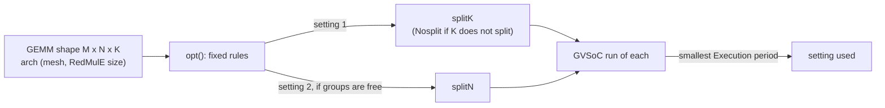
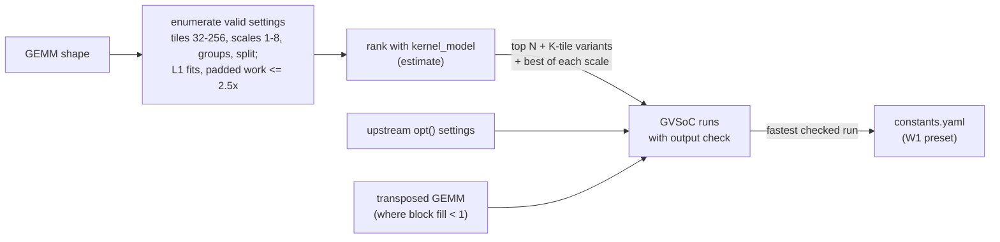
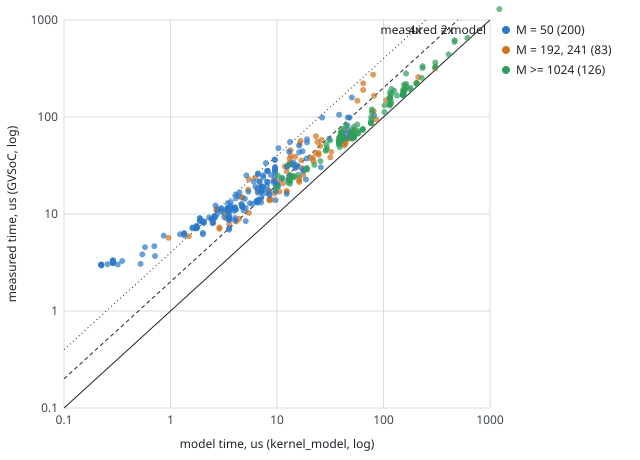

<!-- generated by `python -m workload_modeling.cost_model_doc`; do not edit by hand -->
# Cost model for kernel settings on H1

How a kernel setting (tiles, SUMMA groups, split, FlatAttention blocks) is chosen for each operator on arch H1, and the model that ranks the settings. All numbers are computed from `constants.yaml` and `infra/kernel-runs/results/` when the page is generated. Model times are estimates; measured times are GVSoC runs that passed their output check.

Contents: 1. upstream's design; 2. our strategy; 3. the model; 4. parameters; 5. validation; 6. limits and next steps.

## 1. Upstream's design (gvsoc/gvsoc soft_hier_je)

Read from `implementation/scripts/kernels/auto_config/gemm_auto.py` and `attn_auto.py` (`opt()`), and `scripts/utils/softhier_engine.py` (commit 4610405). `soft_hier_release` and `bowwang-dev/softhier-deeploy` have no other selection code.

### 1.1 Flow: rules give the settings, the simulator chooses



`opt()` predicts no time and compares no costs: it computes at most two settings from the shape, and the engine runs both and keeps the faster. Upstream has a mapping rule, not a cost model (a function that estimates the time of a setting). With two candidates it needs none.

### 1.2 GEMM rules (`gemm_auto.py` `opt()`, lines 46-166)

With `h` = redmule_ce_height (32 on H1), mesh `8 x 8`, tile limit `t = 4h = 128`:

```math
m_t = \min(t, M),\quad n_t = \min(t, N),\qquad s_y = \frac{M}{m_t},\quad s_x = \frac{N}{n_t}
```

A scale that is not a power of 2 is rounded up to one and the tile shrunk to match; then each scale is capped at the mesh:

```math
s \leftarrow 2^{\lceil \log_2 s \rceil},\quad m_t \leftarrow M / s_y,\ n_t \leftarrow N / s_x,\qquad s_x, s_y \leftarrow \min(s, 8),\qquad G_{free} = \frac{64}{s_x s_y}
```

Setting 1, splitK: the most groups that divide `K`, and a K tile near `t`:

```math
g_K = \max\{\,2^i \le G_{free} : 2^i \mid K\,\},\qquadk_t = \begin{cases} K/g_K & K/g_K \le t \\ \max(\mathrm{maxdiv}(K/g_K,\, t),\ 3t/4) & K/g_K < 4t \\ t & \text{otherwise} \end{cases}
```

Setting 2, splitN (only if `G_free > 1` and `N / (s_x n_t) > 1`):

```math
g_N = \min\!\left(G_{free},\ \frac{N}{s_x\, n_t}\right),\qquad k_t = \min(t, K)
```

### 1.3 FlatAttention rule (`attn_auto.py` `opt()`, lines 40-98)

Rows `Y = q · H_q / H_kv` (GQA folds the query heads of one KV head into the rows), columns `X = kv`. The same tile-and-scale rule on each axis, one setting, no search:

```math
B_r = s_y\, y_t,\quad B_c = s_x\, x_t,\qquad \text{async} \iff \text{batch} > G_{free}
```

Upstream does not check that the groups cover every KV head.

### 1.4 The simulator's timing rule (shared)

Both sides simulate with the same GVSoC models: `light_redmule.cpp` `get_redmule_array_runtime`, `hbm_ctrl.cpp` and the NoC model are identical on soft_hier_je and on our tree (ours adds a power source only). A RedMulE call with an `m x n` output tile and reduction `k` is timed in whole output blocks of `h` rows by `w(p+1)` columns, `p+1` cycles per reduction element per block, the reduction rounded up to `w`:

```math
T_{array}(m,n,k) = \left\lceil \frac{m}{h} \right\rceil \left\lceil \frac{n}{w(p+1)} \right\rceil \left\lceil \frac{k}{w} \right\rceil w\,(p+1)\ \text{cycles}
```

On H1 (`h = w = 32`, `p = 1`) a block is 32 x 64: a tile whose width is not a multiple of 64 pays for empty columns. The block fill of a call is its share of useful MACs:

```math
f_{array} = \frac{m\,n\,k}{\lceil m/h\rceil h \cdot \lceil n/(w(p+1))\rceil w(p+1) \cdot \lceil k/w\rceil w}
```

### 1.5 What the rules assume, checked on H1

| upstream rule | implicit assumption | on H1 (our runs) |
| --- | --- | --- |
| tile `4h` = 128 | big enough to hide the per-call overhead, small enough for L1; fills the array | most upstream examples use `w = 16` (32 x 32 blocks, always filled by 128). With H1's 32 x 64 blocks the rescale can break it: 22 of 24 upstream settings have block fill below 1 (e.g. N = 768 gives `n_t = 96`, fill 0.75; the transposed GEMM recovers it) |
| power-of-2 scales, capped at the mesh | SUMMA groups must be powers of 2; more clusters is faster | holds; non-square groups with more than one M step are wrong in SummaGEMM.h:165, upstream never hits it (decode, M = 1) |
| splitK first | the NoC reduction of partial sums costs less than reading X again per N group | holds often: upstream's setting is the fastest checked run for 8 of 21 GEMM shapes (`50x720x960`, `50x720x1440`, `50x720x2048`, `192x960x12288`, `241x320x960`, `241x960x960`, `241x960x2560`, `241x2560x960`). Our sweep had left splitK out for M > 64. But 3 upstream splitK settings give wrong output (see `wrong-output-runs-h1.md`: correct only with all 64 clusters busy and at most 2 N steps per group) |
| two settings, simulate both | the rules land close to the best; no model needed | for GEMM often close; for FlatAttention not (next table) |

FlatAttention, upstream's setting against the fastest checked run:

| shape | upstream setting | µs | fastest checked | µs | upstream / fastest |
| --- | --- | ---: | --- | ---: | ---: |
| `12x1024x1024x64` | `coll_s8x8_b1024x1024` | 140.3 | `async_s8x4_b1024x1024` | 74.3 | 1.89x |
| `15x241x241x64` | `coll_s2x8_b768x256` | not run (drops KV heads) | `coll_s2x4_b768x256` | 17.1 | – |
| `15x50x291x64` | `coll_s4x2_b256x384` | 33.3 | `coll_s8x1_b192x512` | 13.0 | 2.56x |
| `15x50x241x64` | `coll_s2x2_b256x256` | 35.2 | `coll_s8x1_b192x256` | 12.1 | 2.92x |

## 2. Our strategy

The search space is larger than two settings, so a model is needed to choose what to simulate. The simulator still decides.



| | upstream | ours |
| --- | --- | --- |
| candidates | rules give 1-2 | every valid setting (hundreds to thousands per shape) |
| filter | none | `kernel_model` ranking, top N simulated |
| decision | fastest simulated | fastest simulated that passes the output check |
| needs a cost model | no | yes, for ranking only |

Rules for the W1 preset (`infra/kernel-runs/final_runs.py`): per kernel, the fastest checked run over every result set (stage-1 sweeps, upstream settings, transposed GEMM, pipelined Eltwise), re-run once on the current kernel build, then written to `constants.yaml` by `to_constants.py`. A run with wrong output is never a pick.

## 3. The model (`workload_modeling/kernel_model.py`)

One model, used by the GEMM sweeps to rank candidates (`gemm_sweep.model_ns`) and by the kernel explorer (model time in the candidate tooltips, the block fill in the MFU split).

**RedMulE call.** The simulator's rule (1.4) plus a fixed overhead per call, clock `f`:

```math
t_{call}(m,n,k) = \frac{T_{array}(m,n,k) + c_o}{f}
```

**Iterations per cluster** (SummaGEMM.h:142-144), padded sizes `M_p, N_p, K_p`, group `s_x x s_y`, `g` groups:

```math
M_{it} = \left\lceil \frac{M_p}{s_y m_t} \right\rceil,\quad N_{it} = \begin{cases} \lceil N_p / (g\, s_x n_t) \rceil & \text{splitN} \\ \lceil N_p / (s_x n_t)\rceil & \text{otherwise}\end{cases},\quad K_{it} = \begin{cases} \lceil K_p / (g\, k_t) \rceil & \text{splitK} \\ \lceil K_p / k_t\rceil & \text{otherwise}\end{cases}
```

**Compute**, with a reduction step `t_red` per output tile for splitK:

```math
t_{comp} = M_{it} N_{it} K_{it}\, t_{call}(m_t, n_t, k_t) + [\text{splitK}]\, M_{it} N_{it}\, t_{red}
```

**HBM**: SUMMA reads, per group and output step, an X band and a W band of the group's width; Z is written once; fp16 (2 bytes):

```math
B = 2\left( g\, M_{it} N_{it}\, K_g\, (s_y m_t + s_x n_t) + M_p N_p \right),\quad K_g = \begin{cases} K_p / g & \text{splitK} \\ K_p & \text{otherwise}\end{cases},\qquad t_{HBM} = \frac{B}{n_{ch}\, b_{ch}}
```

**Time** (estimate):

```math
t = \max(t_{comp},\ t_{HBM})
```

**Per-call overhead `c_o`.** From the traces of 30 GEMM runs (`trace_summary_h1.json`): RedMulE busy time per cluster divided by the calls per cluster, minus the array time of one call:

```math
c_o = \frac{t_{busy}}{M_{it} N_{it} K_{it}}\,f - T_{array}(m_t, n_t, k_t)
```

median 160 cycles; 29 of 30 runs within 160 ± 15 cycles (range 160 to 256). The array part follows the simulator's rule exactly; the overhead is constant per call whatever the tile.

Not modelled: NoC broadcast and reduction traffic, barriers, pipeline fill and drain, the store of the last tile. These are why the absolute times are short (section 5).

**MFU split** in the kernel explorer (measured MFU, with the model's block fill):

```math
\text{MFU} = \underbrace{\frac{1}{\text{work ratio}}\, f_{array}}_{f_{pad}} \cdot \underbrace{\frac{\text{active clusters}}{64}}_{f_{occ}} \cdot f_{rest}
```

## 4. Parameters

From `constants.yaml` `arch.h1` (the model reads nothing else). Label: measured = read from the arch file or the simulator; inference = derived from a measurement; estimate = chosen or fitted here.

| symbol | key | value | label | source / how chosen |
| --- | --- | ---: | --- | --- |
| `h` | `arch.h1.redmule_h` | 32 CE | measured | arch_h1.py:53 |
| `w` | `arch.h1.redmule_w` | 32 CE | measured | arch_h1.py:54 |
| `p` | `arch.h1.redmule_pipe` | 1 stage | measured | arch_h1.py:55 redmule_ce_pipe (GVSoC LightRedmule times a call in output blocks of redmule_h rows x redmule_w * (redmule_pipe + 1) columns (light_redmule.cpp init_redmule_meta_data)) |
| `f` | `arch.h1.clock_hz` | 1.0e9 Hz | measured | GVSoC soft_hier_release pulp/pulp/chips/flex_cluster/flex_cluster.py (1 GHz cluster clock, as arch.stage1) |
| `c_o` | `arch.h1.redmule_call_overhead` | 160 cycle | estimate | RedMulE busy time per call minus the array time, over the traced GEMM runs (trace_summary_h1.json); computed in workload_modeling/cost_model_doc.py Data.overhead_fit, shown in docs/analysis/cost-model-h1.md section 3 (per RedMulE call; used by workload_modeling.kernel_model (GEMM ranking model and kernel explorer)) |
| `t_red` | `arch.h1.splitk_reduce_step` | 300 ns | estimate | gemm_smallm_sweep.py ranking model, 2026-11-21 (a guess, not fitted) (FlooNoC group reduction of one Z tile per N step in splitK; ranking only) |
| `n_ch` | `arch.h1.hbm_channels` | 16  | measured | arch_h1.py:69 hbm_chan_placement = [8,0,0,8] (8 west, 8 south); one controller per edge (num_node_per_ctrl = hbm_node_aliase = 8, XOR scrambling) |
| `b_ch` | `arch.h1.hbm_bw_per_channel` | 64 GB/s | inference | as arch.stage1.hbm_bw_per_channel (DRAMSys utilization report) (the memspec alone (64 bit x 4000 MT/s) gives 32 GB/s; difference not resolved) |
| `` | `arch.h1.clusters_x` | 8  | measured | arch_h1.py:27 |
| `` | `arch.h1.clusters_y` | 8  | measured | arch_h1.py:28 |
| `` | `arch.h1.tcdm_bytes` | 393216 B | measured | arch_h1.py:35 (0x60000) |

Derived: block 32 x 64 x 32; RedMulE peak 1,024 MAC/ns per cluster; HBM 1,024 GB/s. Sweep limits (driver constants, `gemm_sweep.py`): tiles 32-256 in steps of 32, scales (1, 2, 4, 8), L1 budget 352 KiB for the double buffers, padded work at most 2.5x.

## 5. Validation against the checked runs

409 checked GEMM runs (gemm_sweep, gemm_smallm_sweep, upstream settings, transposed runs on their run shape). A ranking model has to order the settings of one shape; its absolute level matters less.



Points above the line: the model is optimistic. Measured over model for each shape's fastest run: 1.10x to 13.13x (median 2.24x); the gap is largest for M = 50, where fixed costs (barriers, NoC, splitK reduction) dominate a few short RedMulE calls.

Ranking per shape (Spearman rank correlation with the measured times; top choice = measured time of the model's first choice over the fastest run). Mean correlation: **0.84** for kernel_model, 0.49 for the earlier ranking model (1,024 MAC/cycle whatever the tile, 150 ns per call, HBM 200 B/ns). Top choice within 6 % of the fastest: 17 of 21 shapes (earlier model: 12).

Held-out check: 10 runs were added because kernel_model ranked them above the shape's current best; none beat it (`50x1600x720` 1.33x, `50x1600x720` 1.46x, `50x4096x720` 1.40x, `50x4096x720` 1.63x, `50x4096x720` 2.13x, `50x4096x720` 1.69x, `50x4096x720` 1.47x, `50x4096x720` 1.62x, `241x320x960` 1.33x, `1024x768x768` 1.77x of the fastest). Top-choice misses (model's first choice more than 6 % slower than the fastest): `50x1600x720` 1.12x, fastest `splitN_x4y1g16_t64x32x256` (gemm_smallm_sweep); `50x4096x720` 1.26x, fastest `splitN_x2y1g32_t64x64x256` (gemm_smallm_sweep); `241x960x960` 1.25x, fastest `splitK_x8y2g4_t128x128x120` (gemm_upstream); `241x2560x960` 1.09x, fastest `splitN_x8y2g4_t128x80x128` (gemm_upstream). All are M <= 241 shapes whose fastest run spreads the work over several groups, which the model costs only by RedMulE calls and HBM bytes (splitK reduction guessed as `t_red`, NoC traffic not modelled).

| shape | runs | rank corr. earlier | rank corr. kernel_model | top choice earlier | top choice kernel_model | measured / model (fastest) |
| --- | ---: | ---: | ---: | ---: | ---: | ---: |
| `50x32x720` | 7 | 0.75 | 0.61 | 1.00 | 1.00 | 5.84 |
| `50x720x32` | 21 | -0.67 | 0.83 | 1.25 | 1.02 | 13.13 |
| `50x720x720` | 30 | 0.12 | 0.92 | 1.03 | 1.03 | 4.48 |
| `50x720x960` | 22 | 0.42 | 0.95 | 1.00 | 1.00 | 4.42 |
| `50x720x1440` | 20 | 0.52 | 0.92 | 1.00 | 1.00 | 3.54 |
| `50x720x2048` | 19 | 0.62 | 0.90 | 1.00 | 1.00 | 3.20 |
| `50x960x720` | 17 | 0.42 | 0.88 | 1.02 | 1.02 | 4.05 |
| `50x1600x720` | 21 | -0.21 | 0.81 | 1.12 | 1.12 | 2.24 |
| `50x4096x720` | 25 | -0.06 | 0.70 | 1.13 | 1.26 | 1.76 |
| `192x960x12288` | 11 | 0.45 | 0.65 | 2.00 | 1.00 | 1.38 |
| `241x320x320` | 11 | 0.65 | 0.85 | 1.24 | 1.00 | 5.92 |
| `241x320x960` | 13 | 0.69 | 0.88 | 1.68 | 1.00 | 3.27 |
| `241x960x960` | 12 | 0.52 | 0.81 | 1.25 | 1.25 | 2.51 |
| `241x960x2560` | 11 | 0.56 | 0.74 | 1.49 | 1.00 | 1.83 |
| `241x2560x960` | 12 | 0.32 | 0.81 | 1.34 | 1.09 | 1.43 |
| `1024x768x768` | 12 | 0.89 | 0.73 | 1.03 | 1.03 | 1.55 |
| `1024x768x3072` | 12 | 0.87 | 0.97 | 1.00 | 1.00 | 1.17 |
| `1024x3072x768` | 12 | 0.98 | 0.99 | 1.00 | 1.00 | 1.48 |
| `3072x768x768` | 13 | 0.85 | 0.90 | 1.00 | 1.00 | 1.36 |
| `3072x768x3072` | 13 | 0.73 | 0.95 | 1.00 | 1.00 | 1.10 |
| `3072x3072x768` | 12 | 0.92 | 0.93 | 1.00 | 1.00 | 1.32 |

## 6. Limits and next steps

* **Fixed costs.** No term for barriers, NoC collectives or pipeline fill: the fastest run of a shape takes 1.1x to 13.1x the model time, most for M = 50. Next: fit a per-kernel constant and a per-step synchronisation cost to the traced runs.
* **splitK reduction.** `t_red` = 300 ns is a guess, not fitted; splitK runs are the most underestimated. Next: read the reduction time from traces of splitK picks.
* **Correctness is not modelled.** splitK with idle clusters or more than 2 N steps per group gives wrong output (`wrong-output-runs-h1.md`); the model ranks such settings as if they worked, and only the output check removes them.
* **FlatAttention has no model.** `attn_sweep.py` ranks by padded work per busy cluster; upstream's rule is 1.9x to 2.9x slower than the sweep's best. A FlatAttention model (RedMulE calls of the score and output GEMMs, Spatz softmax, NoC row reductions) would make the same split possible.
* **Layouts.** Transposed GEMM times do not include producing X^T or consuming Z^T.

