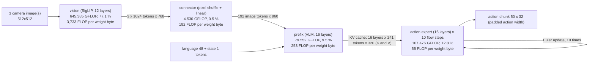

# SmolVLA operator graph: `vlabench-3cam` (W1-b: cameras batched)

<!-- generated by `python -m workload_modeling.build`; do not edit by hand -->

One SmolVLA policy call on `vlabench-3cam` (3 camera(s) at 512x512,
48 language tokens, 1 state token; checkpoint `lerobot/smolvla_base@5e8d12a6`),
broken into operator groups with their compute and memory needs. Numbers come from the standalone model
(`infra/workload-modeling/`), which follows the reference computation at true token counts; its
matrix-product FLOP match PR1's compiled programs within 0.011 % per stage once PR1's padding and rewrites
are applied ([crosscheck.md](crosscheck.md)). Label: inference (model output), cross-checked.
Columns and byte rules: [conventions.md](conventions.md). Units and kernels:
[compiler-walkthrough.md](compiler-walkthrough.md).

Lowering (rewrites of the reference computation used on this page): the expert's cross-attention K/V projection runs once per call, not in every flow step; the cameras are batched into one vision-encoder call (M = cameras x 1024 for every per-token product and row operator; attention stays per camera).

## Totals

| stage | GFLOP | of which matrix | FLOP share % | memory traffic, MB | weights read, MB | FLOP per weight byte |
| --- | ---: | ---: | ---: | ---: | ---: | ---: |
| vision | 645.385 | 641.427 | 77.1 | 5,419.94 | 172.87 | 3,733 |
| connector | 4.530 | 4.530 | 0.5 | 38.85 | 23.59 | 192 |
| prefix | 79.552 | 79.381 | 9.5 | 675.21 | 314.79 | 253 |
| expert | 107.476 | 107.146 | 12.8 | 2,627.34 | 1,967.50 | 55 |
| **total** | 836.944 | 832.483 | 100.0 | 8,761.34 | 2,478.75 | 338 |

Memory traffic: bytes moved if every operator reads its inputs and weights from memory once and writes its output
once (no fusion, no re-reads from tiling; CSV column `bytes_unique`). Weights read: the weight part of that
traffic (`bytes_weight`; each layer's weights once per call, the expert's once per flow step). FLOP per weight byte
= GFLOP / weights read.

FLOP share by class:

| class | GFLOP | share % |
| --- | ---: | ---: |
| gemm | 704.779 | 84.21 |
| attn | 127.704 | 15.26 |
| softmax | 2.494 | 0.30 |
| norm | 0.550 | 0.07 |
| acti | 1.039 | 0.12 |
| elementwise | 0.378 | 0.05 |
| data | 0.000 | 0.00 |

## vision

SigLIP encoder, run once per camera (reference code); attention per camera and head.

| op | layers | class | shape | count | GFLOP | memory traffic, MB | weights read, MB | FLOP per weight byte | unit today | hand-written kernel | kernel us per call |
| --- | --- | --- | --- | ---: | ---: | ---: | ---: | ---: | --- | --- | ---: |
| `patch_embed` | embed | gemm | M 3072, N 768, K 768 | 1 | 3.624 | 10.62 | 1.18 | 3,072 | RedMulE (operands moved by iDMA) | SummaGEMM | 51.96 |
| `bias_patch` | embed | elementwise | 3072 x 768 | 1 | 0.002 | 9.44 | 0.00 | 1,536 | Snitch cores | Eltwise (bias) | 24.92 |
| `pos_embed_add` | embed | elementwise | 3072 x 768 | 1 | 0.002 | 11.01 | 1.57 | 2 | Snitch cores | Eltwise (add) | 34.94 |
| `ln1` | 0-11 | norm | 3072 x 768 | 12 | 0.226 | 113.28 | 0.04 | 6,144 | Snitch cores | LayerNorm | 26.86 |
| `q_proj` | 0-11 | gemm | M 3072, N 768, K 768 | 12 | 43.487 | 127.40 | 14.16 | 3,072 | RedMulE (operands moved by iDMA) | SummaGEMM | 51.96 |
| `bias_q` | 0-11 | elementwise | 3072 x 768 | 12 | 0.028 | 113.26 | 0.02 | 1,536 | Snitch cores | Eltwise (bias) | 24.92 |
| `k_proj` | 0-11 | gemm | M 3072, N 768, K 768 | 12 | 43.487 | 127.40 | 14.16 | 3,072 | RedMulE (operands moved by iDMA) | SummaGEMM | 51.96 |
| `bias_k` | 0-11 | elementwise | 3072 x 768 | 12 | 0.028 | 113.26 | 0.02 | 1,536 | Snitch cores | Eltwise (bias) | 24.92 |
| `v_proj` | 0-11 | gemm | M 3072, N 768, K 768 | 12 | 43.487 | 127.40 | 14.16 | 3,072 | RedMulE (operands moved by iDMA) | SummaGEMM | 51.96 |
| `bias_v` | 0-11 | elementwise | 3072 x 768 | 12 | 0.028 | 113.26 | 0.02 | 1,536 | Snitch cores | Eltwise (bias) | 24.92 |
| `transpose_k` | 0-11 | data | 3072 x 768 | 12 | 0.000 | 113.25 | 0.00 |  | Snitch cores and iDMA | FlatAttention (K transposed on chip by the transpose engine) | in `qk` |
| `qk` | 0-11 | attn | h 12, Sq 1024, Skv 1024, d 64 | 36 | 57.982 | 113.25 | 0.00 |  | RedMulE | FlatAttention | 74.25 |
| `softmax` | 0-11 | softmax | 12288 x 1024 | 36 | 2.265 | 1,811.94 | 0.00 |  | Snitch cores | FlatAttention (softmax on Spatz, inside the kernel) | in `qk` |
| `pv` | 0-11 | attn | h 12, Sq 1024, Skv 1024, d 64 | 36 | 57.982 | 113.25 | 0.00 |  | RedMulE | FlatAttention | in `qk` |
| `o_proj` | 0-11 | gemm | M 3072, N 768, K 768 | 12 | 43.487 | 127.40 | 14.16 | 3,072 | RedMulE (operands moved by iDMA) | SummaGEMM | 51.96 |
| `bias_o` | 0-11 | elementwise | 3072 x 768 | 12 | 0.028 | 113.26 | 0.02 | 1,536 | Snitch cores | Eltwise (bias) | 24.92 |
| `residual_attn` | 0-11 | elementwise | 3072 x 768 | 12 | 0.028 | 169.87 | 0.00 |  | Snitch cores | Eltwise (add) | 34.94 |
| `ln2` | 0-11 | norm | 3072 x 768 | 12 | 0.226 | 113.28 | 0.04 | 6,144 | Snitch cores | LayerNorm | 26.86 |
| `mlp_up` | 0-11 | gemm | M 3072, N 3072, K 768 | 12 | 173.946 | 339.74 | 56.62 | 3,072 | RedMulE (operands moved by iDMA) | SummaGEMM | 150.76 |
| `bias_up` | 0-11 | elementwise | 3072 x 3072 | 12 | 0.113 | 453.06 | 0.07 | 1,536 | Snitch cores | Eltwise (bias) | 57.98 |
| `gelu` | 0-11 | acti | 3072 x 3072 | 12 | 0.906 | 452.98 | 0.00 |  | Snitch cores | Activation (GELU, tanh form) | 66.25 |
| `mlp_down` | 0-11 | gemm | M 3072, N 768, K 3072 | 12 | 173.946 | 339.74 | 56.62 | 3,072 | RedMulE (operands moved by iDMA) | SummaGEMM | 167.29 |
| `bias_down` | 0-11 | elementwise | 3072 x 768 | 12 | 0.028 | 113.26 | 0.02 | 1,536 | Snitch cores | Eltwise (bias) | 24.92 |
| `residual_mlp` | 0-11 | elementwise | 3072 x 768 | 12 | 0.028 | 169.87 | 0.00 |  | Snitch cores | Eltwise (add) | 34.94 |
| `ln_post` | post | norm | 3072 x 768 | 1 | 0.019 | 9.44 | 0.00 | 6,144 | Snitch cores | LayerNorm | 26.86 |

## connector

Pixel shuffle (scale factor 4: 16 patches into one token) and one linear projection to the VLM width.

| op | layers | class | shape | count | GFLOP | memory traffic, MB | weights read, MB | FLOP per weight byte | unit today | hand-written kernel | kernel us per call |
| --- | --- | --- | --- | ---: | ---: | ---: | ---: | ---: | --- | --- | ---: |
| `pixel_shuffle` | - | data | 3072 x 768 | 1 | 0.000 | 9.44 | 0.00 |  | Snitch cores and iDMA | Eltwise (pixel_shuffle, DMA only) | 16.35 |
| `connector_proj` | - | gemm | M 192, N 960, K 12288 | 1 | 4.530 | 28.68 | 23.59 | 192 | RedMulE (operands moved by iDMA) | SummaGEMM | 147.16 |
| `embed_scale` | - | elementwise | 192 x 960 | 1 | 0.000 | 0.74 | 0.00 |  | Snitch cores | Eltwise (scale) | 2.29 |

## prefix

Image, language and state tokens through the kept VLM layers, once per call; the per-layer keys and values are kept as the KV cache the expert reads.

| op | layers | class | shape | count | GFLOP | memory traffic, MB | weights read, MB | FLOP per weight byte | unit today | hand-written kernel | kernel us per call |
| --- | --- | --- | --- | ---: | ---: | ---: | ---: | ---: | --- | --- | ---: |
| `lang_embed_scale` | embed | elementwise | 48 x 960 | 1 | 0.000 | 0.28 | 0.09 | 0 | host (PR1 prepare step) | none |  |
| `state_proj` | embed | gemm | M 1, N 960, K 32 | 1 | 0.000 | 0.06 | 0.06 | 1 | host (PR1 prepare step) | none |  |
| `bias_state` | embed | elementwise | 1 x 960 | 1 | 0.000 | 0.01 | 0.00 | 0 | host (PR1 prepare step) | none |  |
| `rmsnorm_attn` | 0-15 | norm | 241 x 960 | 16 | 0.015 | 14.84 | 0.03 | 482 | Snitch cores | RMSNorm | 4.70 |
| `q_proj` | 0-15 | gemm | M 241, N 960, K 960 | 16 | 7.107 | 44.30 | 29.49 | 241 | RedMulE (operands moved by iDMA) | SummaGEMM | 14.77 |
| `k_proj` | 0-15 | gemm | M 241, N 320, K 960 | 16 | 2.369 | 19.70 | 9.83 | 241 | RedMulE (operands moved by iDMA) | SummaGEMM | 11.47 |
| `v_proj` | 0-15 | gemm | M 241, N 320, K 960 | 16 | 2.369 | 19.70 | 9.83 | 241 | RedMulE (operands moved by iDMA) | SummaGEMM | 11.47 |
| `rope_q` | 0-15 | elementwise | 241 x 960 | 16 | 0.011 | 14.81 | 0.00 |  | Snitch cores | Eltwise (rope) | 3.93 |
| `rope_k` | 0-15 | elementwise | 241 x 320 | 16 | 0.004 | 4.94 | 0.00 |  | Snitch cores | Eltwise (rope) | 2.66 |
| `qk` | 0-15 | attn | h 15, Sq 241, Skv 241, d 64 | 16 | 1.784 | 9.87 | 0.00 |  | RedMulE | FlatAttention; masking not supported | 17.13 |
| `softmax` | 0-15 | softmax | 3615 x 241 | 16 | 0.070 | 55.76 | 0.00 |  | Snitch cores | FlatAttention (softmax on Spatz, inside the kernel) | in `qk` |
| `pv` | 0-15 | attn | h 15, Sq 241, Skv 241, d 64 | 16 | 1.784 | 9.87 | 0.00 |  | RedMulE | FlatAttention; masking not supported | in `qk` |
| `o_proj` | 0-15 | gemm | M 241, N 960, K 960 | 16 | 7.107 | 44.30 | 29.49 | 241 | RedMulE (operands moved by iDMA) | SummaGEMM | 14.77 |
| `residual_attn` | 0-15 | elementwise | 241 x 960 | 16 | 0.004 | 22.21 | 0.00 |  | Snitch cores | Eltwise (add) | 3.70 |
| `rmsnorm_mlp` | 0-15 | norm | 241 x 960 | 16 | 0.015 | 14.84 | 0.03 | 482 | Snitch cores | RMSNorm | 4.70 |
| `mlp_gate` | 0-15 | gemm | M 241, N 2560, K 960 | 16 | 18.953 | 105.79 | 78.64 | 241 | RedMulE (operands moved by iDMA) | SummaGEMM | 27.59 |
| `mlp_up` | 0-15 | gemm | M 241, N 2560, K 960 | 16 | 18.953 | 105.79 | 78.64 | 241 | RedMulE (operands moved by iDMA) | SummaGEMM | 27.59 |
| `silu_mul` | 0-15 | acti | 241 x 2560 | 16 | 0.049 | 59.23 | 0.00 |  | Snitch cores | Activation (SiLU + gate) | 8.73 |
| `mlp_down` | 0-15 | gemm | M 241, N 960, K 2560 | 16 | 18.953 | 105.79 | 78.64 | 241 | RedMulE (operands moved by iDMA) | SummaGEMM | 30.96 |
| `residual_mlp` | 0-15 | elementwise | 241 x 960 | 16 | 0.004 | 22.21 | 0.00 |  | Snitch cores | Eltwise (add) | 3.70 |
| `rmsnorm_final` | tail | norm | 241 x 960 | 1 | 0.001 | 0.93 | 0.00 | 482 | Snitch cores | RMSNorm | 4.70 |

## expert

Flow-matching transformer run once per flow step. Even layers: self-attention over the prefix cache and the action tokens; odd layers: cross-attention to the projected prefix cache. The reference code repeats the cross-attention K/V projection in every step.

| op | layers | class | shape | count | GFLOP | memory traffic, MB | weights read, MB | FLOP per weight byte | unit today | hand-written kernel | kernel us per call |
| --- | --- | --- | --- | ---: | ---: | ---: | ---: | ---: | --- | --- | ---: |
| `cross_k_proj` | cross (1,3..15) | gemm | M 241, N 320, K 320 | 8 | 0.395 | 4.11 | 1.64 | 241 | RedMulE (operands moved by iDMA) | SummaGEMM | 5.67 |
| `cross_v_proj` | cross (1,3..15) | gemm | M 241, N 320, K 320 | 8 | 0.395 | 4.11 | 1.64 | 241 | RedMulE (operands moved by iDMA) | SummaGEMM | 5.67 |
| `action_in_proj` | embed | gemm | M 50, N 720, K 32 | 10 | 0.023 | 1.21 | 0.46 | 50 | RedMulE (operands moved by iDMA) | SummaGEMM | 2.94 |
| `bias_action_in` | embed | elementwise | 50 x 720 | 10 | 0.000 | 1.45 | 0.01 | 25 | Snitch cores | Eltwise (bias) | 1.46 |
| `time_mlp_in` | embed | gemm | M 50, N 720, K 1440 | 10 | 1.037 | 22.90 | 20.74 | 50 | RedMulE (operands moved by iDMA) | SummaGEMM | 9.16 |
| `bias_time_in` | embed | elementwise | 50 x 720 | 10 | 0.000 | 1.45 | 0.01 | 25 | Snitch cores | Eltwise (bias) | 1.46 |
| `time_silu` | embed | acti | 50 x 720 | 10 | 0.001 | 1.44 | 0.00 |  | Snitch cores | Activation (SiLU) | 1.09 |
| `time_mlp_out` | embed | gemm | M 50, N 720, K 720 | 10 | 0.518 | 11.81 | 10.37 | 50 | RedMulE (operands moved by iDMA) | SummaGEMM | 6.02 |
| `bias_time_out` | embed | elementwise | 50 x 720 | 10 | 0.000 | 1.45 | 0.01 | 25 | Snitch cores | Eltwise (bias) | 1.46 |
| `rmsnorm_attn` | 0-15 | norm | 50 x 720 | 160 | 0.023 | 23.27 | 0.23 | 100 | Snitch cores | RMSNorm | 1.61 |
| `qkv_proj` | self (0,2..14) | gemm | M 50, N 1600, K 720 | 80 | 9.216 | 202.88 | 184.32 | 50 | RedMulE (operands moved by iDMA) | SummaGEMM | 10.90 |
| `q_proj` | cross (1,3..15) | gemm | M 50, N 960, K 720 | 80 | 5.530 | 124.03 | 110.59 | 50 | RedMulE (operands moved by iDMA) | SummaGEMM | 7.13 |
| `rope_q` | 0-15 | elementwise | 50 x 960 | 160 | 0.023 | 30.72 | 0.00 |  | Snitch cores | Eltwise (rope) | 1.53 |
| `rope_k` | self (0,2..14) | elementwise | 50 x 320 | 80 | 0.004 | 5.12 | 0.00 |  | Snitch cores | Eltwise (rope) | 1.15 |
| `self_qk` | self (0,2..14) | attn | h 15, Sq 50, Skv 291, d 64 | 80 | 2.235 | 22.58 | 0.00 |  | RedMulE | FlatAttention; masking not supported | 12.98 |
| `self_pv` | self (0,2..14) | attn | h 15, Sq 50, Skv 291, d 64 | 80 | 2.235 | 22.58 | 0.00 |  | RedMulE | FlatAttention; masking not supported | in `self_qk` |
| `self_softmax` | self (0,2..14) | softmax | 750 x 291 | 80 | 0.087 | 69.84 | 0.00 |  | Snitch cores | FlatAttention (softmax on Spatz, inside the kernel) | in `self_qk` |
| `cross_qk` | cross (1,3..15) | attn | h 15, Sq 50, Skv 241, d 64 | 80 | 1.851 | 20.02 | 0.00 |  | RedMulE | FlatAttention; masking not supported | 12.06 |
| `cross_pv` | cross (1,3..15) | attn | h 15, Sq 50, Skv 241, d 64 | 80 | 1.851 | 20.02 | 0.00 |  | RedMulE | FlatAttention; masking not supported | in `cross_qk` |
| `cross_softmax` | cross (1,3..15) | softmax | 750 x 241 | 80 | 0.072 | 57.84 | 0.00 |  | Snitch cores | FlatAttention (softmax on Spatz, inside the kernel) | in `cross_qk` |
| `o_proj` | 0-15 | gemm | M 50, N 720, K 960 | 160 | 11.059 | 248.06 | 221.18 | 50 | RedMulE (operands moved by iDMA) | SummaGEMM | 7.12 |
| `residual_attn` | 0-15 | elementwise | 50 x 720 | 160 | 0.006 | 34.56 | 0.00 |  | Snitch cores | Eltwise (add) | 1.22 |
| `rmsnorm_mlp` | 0-15 | norm | 50 x 720 | 160 | 0.023 | 23.27 | 0.23 | 100 | Snitch cores | RMSNorm | 1.61 |
| `mlp_gateup` | 0-15 | gemm | M 50, N 4096, K 720 | 160 | 47.186 | 1,020.77 | 943.72 | 50 | RedMulE (operands moved by iDMA) | SummaGEMM | 17.08 |
| `silu_mul` | 0-15 | acti | 50 x 2048 | 160 | 0.082 | 98.30 | 0.00 |  | Snitch cores | Activation (SiLU + gate) | 2.46 |
| `mlp_down` | 0-15 | gemm | M 50, N 720, K 2048 | 160 | 23.593 | 516.15 | 471.86 | 50 | RedMulE (operands moved by iDMA) | SummaGEMM | 11.13 |
| `residual_mlp` | 0-15 | elementwise | 50 x 720 | 160 | 0.006 | 34.56 | 0.00 |  | Snitch cores | Eltwise (add) | 1.22 |
| `rmsnorm_final` | out | norm | 50 x 720 | 10 | 0.001 | 1.45 | 0.01 | 100 | Snitch cores | RMSNorm | 1.61 |
| `action_out_proj` | out | gemm | M 50, N 32, K 720 | 10 | 0.023 | 1.21 | 0.46 | 50 | RedMulE (operands moved by iDMA) | SummaGEMM | 3.06 |
| `bias_action_out` | out | elementwise | 50 x 32 | 10 | 0.000 | 0.06 | 0.00 | 25 | Snitch cores | Eltwise (bias) | 1.17 |
| `euler_update` | out | elementwise | 50 x 32 | 10 | 0.000 | 0.10 | 0.00 |  | Snitch cores | Eltwise (axpy) | 1.11 |

## Composed estimate from hand-written kernels

"kernel us per call" is the operator's hand-written kernel simulated alone at one instance of the operator:
kernel repo `HaozeG/gvsoc@aa57690` (branch gelu-layernorm-kernels, the frozen stage-1 build), H1 (64 clusters, RedMulE 32 x 32, Spatz on 4 cores per cluster), GVSoC with the SoftHier-VLA patch series 0001-0012, DRAMSys HBM; protocol: docs/designs/stage1-spec.md §4.3. Label: measured per call. Values, settings and sources: `constants.yaml` section
`h1_kernels`. "in `qk`" marks work done inside that row's kernel call: FlatAttention runs QK^T, softmax and
P.V in one call and transposes K on chip.

Hardware the kernels ran on: H1, `infra/kernel-runs/arch/arch_h1.py` (`constants.yaml` section `arch.h1`). Read from
the arch file: measured; totals computed from it: inference.

| part | setting |
| --- | --- |
| mesh | 8 x 8 = 64 clusters at 1 GHz |
| cluster | 5 Snitch cores: 4 with a Spatz vector unit (4 FPUs, VLEN 16384 bit), one data-mover core driving the iDMA |
| matrix unit | RedMulE 32 x 32 CE per cluster, fp16: 2.048 TFLOP/s per cluster, 131.1 TFLOP/s in total |
| L1 (TCDM) | 384 KiB per cluster, 24 MiB in total |
| NoC | 1024-bit links |
| HBM | 16 channels on the west and south edges, DRAMSys model (JEDEC HBM2E-4000, 64-bit, 2000 MHz, DDR); 64 GB/s per channel, 1024 GB/s in total (inference: from DRAMSys's utilization report; the memspec alone gives half) |
| balance | peak / HBM bandwidth = 128 FLOP per byte: an operator below this FLOP per byte of HBM traffic is bandwidth-bound here |

| kernel | operators | output checked | how it was run |
| --- | --- | --- | --- |
| SummaGEMM | every matrix product | yes, bit-exact against a replay golden | M, N, K padded to tile multiples (stage-1 store fix); tile, scale and Nosplit or split-N: fastest checked setting of a sweep per shape, re-run on the frozen build |
| FlatAttention | QK^T, softmax, P.V | yes, within 0.02 of a float64 golden | no masking (prefix and expert need one: approximation); GQA folds query heads; group shape, blocks and collective or async mode: fastest checked setting of a sweep; sequence lengths padded to a block multiple |
| LayerNorm, Activation, Eltwise | norms, activations, elementwise, pixel shuffle | yes, bit-exact against a replay golden | one run per shape, exact shape |
| RMSNorm | RMSNorm | yes, 32 ULP against float64 x / rms(x) | one run per shape; the kernel has no weight and no eps (one multiply per element short) |

Every time comes from a run whose output check passed on all 64 clusters, under `MALLOC_PERTURB_` (uninitialised simulator memory would show). Simulator fixes found on the way (RedMulE buffers, FlooNoC reductions) are patches 0011 and 0012.

The composed time is the sum over operators of count x time per call. Label: estimate. It assumes kernels
run back to back with nothing between them: no overlap, no layout change between kernels (the projections write
token-major rows, FlatAttention reads head-major Q, K, V), and every kernel starting and ending in HBM.
It is on H1 with DRAMSys HBM, not PR1's arch with ideal HBM. Per-call times move by about 3 %
with code placement alone (GELU: 68.1 to 70.5 us for the same loop at a 12-byte offset, mechanism not
identified).

| stage | GEMM, us | attention, us | row operators, us | total, us | GFLOP | MFU, % | inside another call | not covered |
| --- | ---: | ---: | ---: | ---: | ---: | ---: | --- | --- |
| vision | 6,362.6 | 2,673.1 | 4,555.7 | 13,591.3 | 645.4 | 36.2 | `transpose_k` (in `qk`), `softmax` (in `qk`), `pv` (in `qk`) | none |
| connector | 147.2 | 0.0 | 18.6 | 165.8 | 4.5 | 20.8 | none | none |
| prefix | 2,218.0 | 274.1 | 518.4 | 3,010.4 | 79.6 | 20.2 | `softmax` (in `qk`), `pv` (in `qk`) | `lang_embed_scale` (host), `state_proj` (host), `bias_state` (host) |
| expert | 7,398.2 | 2,003.0 | 1,727.8 | 11,129.1 | 107.5 | 7.4 | `self_pv` (in `self_qk`), `self_softmax` (in `self_qk`), `cross_pv` (in `cross_qk`), `cross_softmax` (in `cross_qk`) | none |
| **all** | 16,125.9 | 4,950.2 | 6,820.6 | **27,896.6** | 836.9 | **22.9** | | |

Total: 27.90 ms per inference call (estimate); shares: GEMM 58 %, attention
18 %, row operators 24 %.

MFU (estimate) = nominal FLOP / (composed time x 131.1 TFLOP/s, the matrix-unit peak above). FLOP are
the model's unpadded counts of the covered operators (padding and the work of host rows not counted); row
operators count their per-element conventions against the same matrix peak, so their MFU is near zero by
construction. Per class: GEMM 33.3 %, attention 20.1 %, row operators 0.2 %.

## Limitations

* **No tiling re-reads.** Bytes count each operand once per operator instance; re-reads caused by tiling
  (for example the M = 50 expert products re-reading X per column tile in PR1) are left to the measurement work.
* **Weightless operators have no intensity.** Attention, softmax and activations have no weight bytes; their
  cost on SoftHier is set by core issue rate and data movement, not by this column.
* **Weights re-read per flow step.** The expert's weights (about 200 MB per step) do not fit on chip, so the
  model reads them in every step; keeping tiles on chip is RQ2.
* **Per-element FLOP for non-matrix classes are conventions** (inference), small next to the matrix products.
