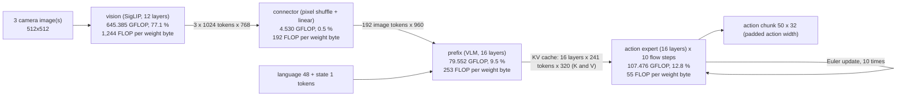

# SmolVLA on SoftHier: time, MFU and operator needs for `vlabench-3cam`

<!-- generated by `python -m workload_modeling.build`; do not edit by hand -->

This page estimates how long one SmolVLA policy call takes on SoftHier, built from hand-written kernels that were
each simulated alone, and lists every operator of the call with its compute and memory needs.

## Results at a glance

**39.16 ms per policy call, MFU 16.3 %** (estimate; premises below).

| stage | time, ms | share of time, % | GFLOP | MFU, % |
| --- | ---: | ---: | ---: | ---: |
| vision | 20.98 | 54 | 645.4 | 23.5 |
| connector | 0.10 | 0 | 4.5 | 36.1 |
| prefix | 2.92 | 7 | 79.6 | 20.8 |
| expert | 15.16 | 39 | 107.5 | 5.4 |
| **all** | **39.16** | 100 | 836.9 | **16.3** |

By kind of operator: matrix products (GEMM) take 54 % of the time at MFU 25.2 %,
attention 22 % at MFU 11.4 %, and row operators (norms, activations, elementwise; they
run on the vector cores, not the matrix unit) 23 %. Judge row operators by their time, not their MFU:
their few FLOP are divided by the matrix-unit peak, so their MFU (0.2 %) is near zero by construction.

MFU (model FLOPs utilization) = FLOP of the model / (time x 131.1 TFLOP/s, the fp16 peak of all matrix
units). FLOP are the model's true counts, without padding.

## What these numbers assume

* **Workload.** 3 camera(s) at 512x512, 48 language tokens,
  1 state token, 10 flow steps; checkpoint `lerobot/smolvla_base@5e8d12a6`.
* **Model.** Operators, shapes and FLOP come from the project's standalone SmolVLA model (`infra/workload-modeling/`),
  which follows the lerobot reference code at true token counts. Its matrix FLOP agree with PR1's compiled programs
  within 0.011 % per stage ([crosscheck.md](crosscheck.md)).
* **Changes from the reference computation.** The expert's cross-attention K/V projection runs once per call, not in every flow step.
* **Hardware.** H1, `infra/kernel-runs/arch/arch_h1.py` (`constants.yaml` section `arch.h1`): 8 x 8 = 64 clusters at 1 GHz,
  131.1 TFLOP/s fp16 peak, HBM 1024 GB/s (DRAMSys's peak,
  16 channels x 64 GB/s). Details in [Hardware and kernels](#hardware-and-kernels).
* **Kernel times are measured**, one kernel at a time on one instance of the operator, in the GVSoC simulator, with
  each output checked against a golden reference.
* **The call time is a sum, not a run.** Time per call = sum over operators of (instances x kernel time). Kernels run
  back to back with no overlap, each starts and ends in HBM, and changing data layout between kernels costs nothing.
* **Padding is in the time, not in the FLOP.** GEMM dimensions are padded to tile multiples and attention sequence
  lengths to block multiples, so the times include the padded work; MFU counts only the true FLOP.
* **Attention has no mask.** The kernel cannot mask yet, so prefix and expert attention are timed unmasked
  (an approximation).
* **Not timed:** `lang_embed_scale` (prefix), `state_proj` (prefix), `bias_state` (prefix). They run on the host before the call (PR1's prepare step).

Labels: *measured* = read from a simulator run or an input file; *estimate* = computed from measured values under the
assumptions above; *inference* = a conclusion drawn from other numbers, such as the model's FLOP counts
([conventions.md](conventions.md#evidence-labels)).

## Time per stage and kind of operator

Time per call in µs, summed from the kernel times (estimate). Some operators have no time of their own because a
kernel does their work inside another operator's call: FlatAttention computes QK^T, softmax and P.V in one call and
transposes K on chip, so their time is counted on the `qk` row.

| stage | GEMM, µs | attention, µs | row operators, µs | total, µs | GFLOP | MFU, % | done inside another operator's kernel | no kernel time |
| --- | ---: | ---: | ---: | ---: | ---: | ---: | --- | --- |
| vision | 9,474.8 | 5,051.9 | 6,451.2 | 20,977.8 | 645.4 | 23.5 | `transpose_k`, `softmax`, `pv` (timed in `qk`) | none |
| connector | 73.5 | 0.0 | 22.2 | 95.7 | 4.5 | 36.1 | none | none |
| prefix | 1,897.1 | 416.0 | 608.5 | 2,921.6 | 79.6 | 20.8 | `softmax`, `pv` (timed in `qk`) | `lang_embed_scale` (host), `state_proj` (host), `bias_state` (host) |
| expert | 9,880.4 | 3,269.2 | 2,011.1 | 15,160.6 | 107.5 | 5.4 | `self_pv`, `self_softmax` (timed in `self_qk`); `cross_pv`, `cross_softmax` (timed in `cross_qk`) | none |
| **all** | 21,325.7 | 8,737.1 | 9,092.9 | **39,155.8** | 836.9 | **16.3** | | |

## Totals

Compute and memory needs of the model alone (no hardware). Matrix GFLOP: GEMM plus attention's QK^T and P.V.

| stage | GFLOP | matrix GFLOP | share of FLOP, % | memory traffic, MB | weights read, MB | FLOP per weight byte |
| --- | ---: | ---: | ---: | ---: | ---: | ---: |
| vision | 645.385 | 641.427 | 77.1 | 5,765.67 | 518.60 | 1,244 |
| connector | 4.530 | 4.530 | 0.5 | 38.85 | 23.59 | 192 |
| prefix | 79.552 | 79.381 | 9.5 | 675.21 | 314.79 | 253 |
| expert | 107.476 | 107.146 | 12.8 | 2,650.38 | 1,967.50 | 55 |
| **total** | 836.944 | 832.483 | 100.0 | 9,130.12 | 2,824.48 | 296 |

Memory traffic: bytes moved if every operator reads its inputs and weights from memory once and writes its output
once (no fusion, no re-reads from tiling; CSV column `memory_traffic_bytes`). Weights read: the weight part of that
traffic (`weights_read_bytes`; each layer's weights once per call, the expert's once per flow step). FLOP per weight
byte = GFLOP / weights read: below the hardware's balance (128 FLOP per byte here), a stage that streams
its weights from HBM is limited by bandwidth.

Share of FLOP by class:

| class | GFLOP | share, % |
| --- | ---: | ---: |
| gemm | 704.779 | 84.21 |
| attn | 127.704 | 15.26 |
| softmax | 2.494 | 0.30 |
| norm | 0.550 | 0.07 |
| acti | 1.039 | 0.12 |
| elementwise | 0.378 | 0.05 |
| data | 0.000 | 0.00 |

## Hardware and kernels

Kernel build: the stage-1 baseline: upstream's whole-graph HBM plan and kernel-selection rule (decision 2026-11-25; `workload_modeling/deploy_plan.py`, `upstream_rules.py`), kernel repo branch `upstream-deployment-plan` (submodule `third_party/softhier-kernels`), H1 (64 clusters, RedMulE 32 x 32, Spatz on 4 cores per cluster), GVSoC with the SoftHier-VLA patch series, DRAMSys HBM; runs and selection: `infra/kernel-runs/plan_runs.py`. Kernel times and their run settings: `constants.yaml` section `h1_plan`.
Hardware: H1, `infra/kernel-runs/arch/arch_h1.py` (`constants.yaml` section `arch.h1`). Values read from the arch file are measured; totals computed from them are inference.

| part | setting |
| --- | --- |
| mesh | 8 x 8 = 64 clusters at 1 GHz |
| cluster | 5 Snitch cores: 4 with a Spatz vector unit (4 FPUs, VLEN 16384 bit), one data-mover core driving the iDMA |
| matrix unit | RedMulE 32 x 32 CE per cluster, fp16: 2.048 TFLOP/s per cluster, 131.1 TFLOP/s in total |
| L1 (TCDM) | 384 KiB per cluster, 24 MiB in total |
| NoC | 1024-bit links |
| HBM | 16 channels on the west and south edges, DRAMSys model (JEDEC HBM2E-4000, 64-bit, 2000 MHz, DDR); 64 GB/s per channel, 1024 GB/s in total (measured: DRAMSys's MAX BW per controller; memspec 2 pseudo-channels x 64 bit x 4000 MT/s) |
| balance | peak / HBM bandwidth = 128 FLOP per byte: an operator below this FLOP per byte of HBM traffic is bandwidth-bound here |

| kernel | operators | output checked | how it was run |
| --- | --- | --- | --- |
| SummaGEMM | every matrix product; q / k / v and gate / up as separate products | yes, bit-exact (Nosplit, splitN) or within 0.02 absolute (splitK) of a replay golden | upstream `opt()` candidates, both simulated, the faster passing one kept; projections into and out of attention write / read the head-major layout (reshape), padded by whole zero heads |
| FlatAttention | QK^T, softmax, P.V | yes, within 0.02 of a float64 golden | upstream `attn_auto` setting with recorded fixes (padding, head coverage, row tile); no masking |
| Activation, LayerNorm, RMSNorm, Eltwise, RoPE | residual adds (Activation `none` + bias), norms, activations, elementwise, RoPE (upstream kernel, head-major view) | yes, bit-exact against a replay golden (RMSNorm 32 ULP) | one run per shape at default parameters |

Every time comes from a run whose output check passed on all 64 clusters. Where upstream's own setting fails the check, the nearest passing setting is used and recorded per run (`results/plan_runs_h1.csv`, column fix).

It is on H1 with DRAMSys HBM, not PR1's arch with ideal HBM.

## Operators: vision

SigLIP encoder, run once per camera (reference code); attention per camera and head.

The last four columns compare the two implementations of each operator: the unit PR1's compiled program ran it on,
and the stage-1 hand-written kernel that does it now, with the units that kernel uses and its measured time for one
instance. Sources: PR1's unit from reading PR1's compiler path ([compiler-walkthrough.md](compiler-walkthrough.md))
and its arch file (no Spatz); the stage-1 units from the busy unit tracks in the H1 kernel traces (measured), except
the NoC broadcast and the transpose engine, which have no trace track and come from the kernel source.

| op | layers | class | shape | count | GFLOP | memory traffic, MB | weights read, MB | FLOP per weight byte | PR1: unit | stage 1: hand-written kernel | stage 1: units | stage 1: time per call, µs |
| --- | --- | --- | --- | ---: | ---: | ---: | ---: | ---: | --- | --- | --- | ---: |
| `patch_embed` | embed | gemm | M 1024, N 768, K 768 | 3 | 3.624 | 12.98 | 3.54 | 1,024 | RedMulE (operands moved by iDMA) | SummaGEMM | RedMulE; operands by iDMA and NoC (SUMMA broadcast) | 20.48 |
| `bias_patch` | embed | elementwise | 1024 x 768 | 3 | 0.002 | 9.44 | 0.00 | 512 | Snitch cores (scalar; Spatz off in PR1) | Eltwise (bias) | Spatz on 4 cores, data by iDMA | 8.76 |
| `pos_embed_add` | embed | elementwise | 1024 x 768 | 3 | 0.002 | 14.16 | 4.72 | 0 | Snitch cores (scalar; Spatz off in PR1) | Eltwise (add) | Spatz on 4 cores, data by iDMA | 13.49 |
| `ln1` | 0-11 | norm | 1024 x 768 | 36 | 0.226 | 113.36 | 0.11 | 2,048 | Snitch cores (scalar; Spatz off in PR1) | LayerNorm | Spatz on 4 cores, data by iDMA | 11.27 |
| `q_proj` | 0-11 | gemm | M 1024, N 768, K 768 | 36 | 43.487 | 155.71 | 42.47 | 1,024 | RedMulE (operands moved by iDMA) | SummaGEMM | RedMulE; operands by iDMA and NoC (SUMMA broadcast) | 33.50 |
| `bias_q` | 0-11 | elementwise | 1024 x 768 | 36 | 0.028 | 113.30 | 0.06 | 512 | Snitch cores (scalar; Spatz off in PR1) | Eltwise (bias) | Spatz on 4 cores, data by iDMA | 12.92 |
| `k_proj` | 0-11 | gemm | M 1024, N 768, K 768 | 36 | 43.487 | 155.71 | 42.47 | 1,024 | RedMulE (operands moved by iDMA) | SummaGEMM | RedMulE; operands by iDMA and NoC (SUMMA broadcast) | 31.23 |
| `bias_k` | 0-11 | elementwise | 1024 x 768 | 36 | 0.028 | 113.30 | 0.06 | 512 | Snitch cores (scalar; Spatz off in PR1) | Eltwise (bias) | Spatz on 4 cores, data by iDMA | 13.02 |
| `v_proj` | 0-11 | gemm | M 1024, N 768, K 768 | 36 | 43.487 | 155.71 | 42.47 | 1,024 | RedMulE (operands moved by iDMA) | SummaGEMM | RedMulE; operands by iDMA and NoC (SUMMA broadcast) | 31.23 |
| `bias_v` | 0-11 | elementwise | 1024 x 768 | 36 | 0.028 | 113.30 | 0.06 | 512 | Snitch cores (scalar; Spatz off in PR1) | Eltwise (bias) | Spatz on 4 cores, data by iDMA | 13.02 |
| `transpose_k` | 0-11 | data | 1024 x 768 | 36 | 0.000 | 113.25 | 0.00 |  | Snitch cores and iDMA | FlatAttention (part of the QK^T call) | transpose engine, in L1 | timed in `qk` |
| `qk` | 0-11 | attn | h 12, Sq 1024, Skv 1024, d 64 | 36 | 57.982 | 113.25 | 0.00 |  | RedMulE | FlatAttention | RedMulE (QK^T, P.V), Spatz (softmax); data by iDMA | 140.33 |
| `softmax` | 0-11 | softmax | 12288 x 1024 | 36 | 2.265 | 1,811.94 | 0.00 |  | Snitch cores (scalar; Spatz off in PR1) | FlatAttention (part of the QK^T call) | Spatz (vfredmax, vfexp), inside FlatAttention | timed in `qk` |
| `pv` | 0-11 | attn | h 12, Sq 1024, Skv 1024, d 64 | 36 | 57.982 | 113.25 | 0.00 |  | RedMulE | FlatAttention | RedMulE (QK^T, P.V), Spatz (softmax); data by iDMA | timed in `qk` |
| `o_proj` | 0-11 | gemm | M 1024, N 768, K 768 | 36 | 43.487 | 155.71 | 42.47 | 1,024 | RedMulE (operands moved by iDMA) | SummaGEMM | RedMulE; operands by iDMA and NoC (SUMMA broadcast) | 24.98 |
| `bias_o` | 0-11 | elementwise | 1024 x 768 | 36 | 0.028 | 113.30 | 0.06 | 512 | Snitch cores (scalar; Spatz off in PR1) | Eltwise (bias) | Spatz on 4 cores, data by iDMA | 9.91 |
| `residual_attn` | 0-11 | elementwise | 1024 x 768 | 36 | 0.028 | 169.87 | 0.00 |  | Snitch cores (scalar; Spatz off in PR1) | Eltwise (add) | Spatz on 4 cores, data by iDMA | 12.30 |
| `ln2` | 0-11 | norm | 1024 x 768 | 36 | 0.226 | 113.36 | 0.11 | 2,048 | Snitch cores (scalar; Spatz off in PR1) | LayerNorm | Spatz on 4 cores, data by iDMA | 11.27 |
| `mlp_up` | 0-11 | gemm | M 1024, N 3072, K 768 | 36 | 173.946 | 452.98 | 169.87 | 1,024 | RedMulE (operands moved by iDMA) | SummaGEMM | RedMulE; operands by iDMA and NoC (SUMMA broadcast) | 79.64 |
| `bias_up` | 0-11 | elementwise | 1024 x 3072 | 36 | 0.113 | 453.21 | 0.22 | 512 | Snitch cores (scalar; Spatz off in PR1) | Eltwise (bias) | Spatz on 4 cores, data by iDMA | 32.97 |
| `gelu` | 0-11 | acti | 1024 x 3072 | 36 | 0.906 | 452.98 | 0.00 |  | Snitch cores (scalar; Spatz off in PR1) | Activation (GELU, tanh form) | Spatz on 4 cores, data by iDMA | 37.51 |
| `mlp_down` | 0-11 | gemm | M 1024, N 768, K 3072 | 36 | 173.946 | 452.98 | 169.87 | 1,024 | RedMulE (operands moved by iDMA) | SummaGEMM | RedMulE; operands by iDMA and NoC (SUMMA broadcast) | 60.90 |
| `bias_down` | 0-11 | elementwise | 1024 x 768 | 36 | 0.028 | 113.30 | 0.06 | 512 | Snitch cores (scalar; Spatz off in PR1) | Eltwise (bias) | Spatz on 4 cores, data by iDMA | 9.91 |
| `residual_mlp` | 0-11 | elementwise | 1024 x 768 | 36 | 0.028 | 169.87 | 0.00 |  | Snitch cores (scalar; Spatz off in PR1) | Eltwise (add) | Spatz on 4 cores, data by iDMA | 12.30 |
| `ln_post` | post | norm | 1024 x 768 | 3 | 0.019 | 9.45 | 0.01 | 2,048 | Snitch cores (scalar; Spatz off in PR1) | LayerNorm | Spatz on 4 cores, data by iDMA | 11.27 |

## Operators: connector

Pixel shuffle (scale factor 4: 16 patches into one token) and one linear projection to the VLM width.

The last four columns compare the two implementations of each operator: the unit PR1's compiled program ran it on,
and the stage-1 hand-written kernel that does it now, with the units that kernel uses and its measured time for one
instance. Sources: PR1's unit from reading PR1's compiler path ([compiler-walkthrough.md](compiler-walkthrough.md))
and its arch file (no Spatz); the stage-1 units from the busy unit tracks in the H1 kernel traces (measured), except
the NoC broadcast and the transpose engine, which have no trace track and come from the kernel source.

| op | layers | class | shape | count | GFLOP | memory traffic, MB | weights read, MB | FLOP per weight byte | PR1: unit | stage 1: hand-written kernel | stage 1: units | stage 1: time per call, µs |
| --- | --- | --- | --- | ---: | ---: | ---: | ---: | ---: | --- | --- | --- | ---: |
| `pixel_shuffle` | - | data | 3072 x 768 | 1 | 0.000 | 9.44 | 0.00 |  | Snitch cores and iDMA | Eltwise (pixel_shuffle) | iDMA only (one 2D copy per output row) | 19.95 |
| `connector_proj` | - | gemm | M 192, N 960, K 12288 | 1 | 4.530 | 28.68 | 23.59 | 192 | RedMulE (operands moved by iDMA) | SummaGEMM | RedMulE; operands by iDMA and NoC (SUMMA broadcast) | 73.49 |
| `embed_scale` | - | elementwise | 192 x 960 | 1 | 0.000 | 0.74 | 0.00 |  | Snitch cores (scalar; Spatz off in PR1) | Eltwise (scale) | Spatz on 4 cores, data by iDMA | 2.29 |

## Operators: prefix

Image, language and state tokens through the kept VLM layers, once per call; the per-layer keys and values are kept as the KV cache the expert reads.

The last four columns compare the two implementations of each operator: the unit PR1's compiled program ran it on,
and the stage-1 hand-written kernel that does it now, with the units that kernel uses and its measured time for one
instance. Sources: PR1's unit from reading PR1's compiler path ([compiler-walkthrough.md](compiler-walkthrough.md))
and its arch file (no Spatz); the stage-1 units from the busy unit tracks in the H1 kernel traces (measured), except
the NoC broadcast and the transpose engine, which have no trace track and come from the kernel source.

| op | layers | class | shape | count | GFLOP | memory traffic, MB | weights read, MB | FLOP per weight byte | PR1: unit | stage 1: hand-written kernel | stage 1: units | stage 1: time per call, µs |
| --- | --- | --- | --- | ---: | ---: | ---: | ---: | ---: | --- | --- | --- | ---: |
| `lang_embed_scale` | embed | elementwise | 48 x 960 | 1 | 0.000 | 0.28 | 0.09 | 0 | host (PR1 prepare step) | none |  |  |
| `state_proj` | embed | gemm | M 1, N 960, K 32 | 1 | 0.000 | 0.06 | 0.06 | 1 | host (PR1 prepare step) | none |  |  |
| `bias_state` | embed | elementwise | 1 x 960 | 1 | 0.000 | 0.01 | 0.00 | 0 | host (PR1 prepare step) | none |  |  |
| `rmsnorm_attn` | 0-15 | norm | 241 x 960 | 16 | 0.015 | 14.84 | 0.03 | 482 | Snitch cores (scalar; Spatz off in PR1) | RMSNorm | Spatz on 1 core (upstream kernel), data by iDMA | 4.64 |
| `q_proj` | 0-15 | gemm | M 241, N 960, K 960 | 16 | 7.107 | 44.30 | 29.49 | 241 | RedMulE (operands moved by iDMA) | SummaGEMM | RedMulE; operands by iDMA and NoC (SUMMA broadcast) | 13.84 |
| `k_proj` | 0-15 | gemm | M 241, N 320, K 960 | 16 | 2.369 | 19.70 | 9.83 | 241 | RedMulE (operands moved by iDMA) | SummaGEMM | RedMulE; operands by iDMA and NoC (SUMMA broadcast) | 10.35 |
| `v_proj` | 0-15 | gemm | M 241, N 320, K 960 | 16 | 2.369 | 19.70 | 9.83 | 241 | RedMulE (operands moved by iDMA) | SummaGEMM | RedMulE; operands by iDMA and NoC (SUMMA broadcast) | 10.35 |
| `rope_q` | 0-15 | elementwise | 241 x 960 | 16 | 0.011 | 14.81 | 0.00 |  | Snitch cores (scalar; Spatz off in PR1) | Eltwise (rope) | Spatz on 4 cores, data by iDMA | 5.42 |
| `rope_k` | 0-15 | elementwise | 241 x 320 | 16 | 0.004 | 4.94 | 0.00 |  | Snitch cores (scalar; Spatz off in PR1) | Eltwise (rope) | Spatz on 4 cores, data by iDMA | 3.38 |
| `qk` | 0-15 | attn | h 15, Sq 241, Skv 241, d 64 | 16 | 1.784 | 9.87 | 0.00 |  | RedMulE | FlatAttention; masking not supported | RedMulE (QK^T, P.V), Spatz (softmax); data by iDMA | 26.00 |
| `softmax` | 0-15 | softmax | 3615 x 241 | 16 | 0.070 | 55.76 | 0.00 |  | Snitch cores (scalar; Spatz off in PR1) | FlatAttention (part of the QK^T call) | Spatz (vfredmax, vfexp), inside FlatAttention | timed in `qk` |
| `pv` | 0-15 | attn | h 15, Sq 241, Skv 241, d 64 | 16 | 1.784 | 9.87 | 0.00 |  | RedMulE | FlatAttention; masking not supported | RedMulE (QK^T, P.V), Spatz (softmax); data by iDMA | timed in `qk` |
| `o_proj` | 0-15 | gemm | M 241, N 960, K 960 | 16 | 7.107 | 44.30 | 29.49 | 241 | RedMulE (operands moved by iDMA) | SummaGEMM | RedMulE; operands by iDMA and NoC (SUMMA broadcast) | 12.72 |
| `residual_attn` | 0-15 | elementwise | 241 x 960 | 16 | 0.004 | 22.21 | 0.00 |  | Snitch cores (scalar; Spatz off in PR1) | Eltwise (add) | Spatz on 4 cores, data by iDMA | 4.59 |
| `rmsnorm_mlp` | 0-15 | norm | 241 x 960 | 16 | 0.015 | 14.84 | 0.03 | 482 | Snitch cores (scalar; Spatz off in PR1) | RMSNorm | Spatz on 1 core (upstream kernel), data by iDMA | 4.64 |
| `mlp_gate` | 0-15 | gemm | M 241, N 2560, K 960 | 16 | 18.953 | 105.79 | 78.64 | 241 | RedMulE (operands moved by iDMA) | SummaGEMM | RedMulE; operands by iDMA and NoC (SUMMA broadcast) | 25.30 |
| `mlp_up` | 0-15 | gemm | M 241, N 2560, K 960 | 16 | 18.953 | 105.79 | 78.64 | 241 | RedMulE (operands moved by iDMA) | SummaGEMM | RedMulE; operands by iDMA and NoC (SUMMA broadcast) | 25.30 |
| `silu_mul` | 0-15 | acti | 241 x 2560 | 16 | 0.049 | 59.23 | 0.00 |  | Snitch cores (scalar; Spatz off in PR1) | Activation (SiLU + gate) | Spatz on 4 cores, data by iDMA | 10.47 |
| `mlp_down` | 0-15 | gemm | M 241, N 960, K 2560 | 16 | 18.953 | 105.79 | 78.64 | 241 | RedMulE (operands moved by iDMA) | SummaGEMM | RedMulE; operands by iDMA and NoC (SUMMA broadcast) | 20.73 |
| `residual_mlp` | 0-15 | elementwise | 241 x 960 | 16 | 0.004 | 22.21 | 0.00 |  | Snitch cores (scalar; Spatz off in PR1) | Eltwise (add) | Spatz on 4 cores, data by iDMA | 4.59 |
| `rmsnorm_final` | tail | norm | 241 x 960 | 1 | 0.001 | 0.93 | 0.00 | 482 | Snitch cores (scalar; Spatz off in PR1) | RMSNorm | Spatz on 1 core (upstream kernel), data by iDMA | 4.64 |

## Operators: expert

Flow-matching transformer run once per flow step. Even layers: self-attention over the prefix cache and the action tokens; odd layers: cross-attention to the projected prefix cache. The reference code repeats the cross-attention K/V projection in every step.

The last four columns compare the two implementations of each operator: the unit PR1's compiled program ran it on,
and the stage-1 hand-written kernel that does it now, with the units that kernel uses and its measured time for one
instance. Sources: PR1's unit from reading PR1's compiler path ([compiler-walkthrough.md](compiler-walkthrough.md))
and its arch file (no Spatz); the stage-1 units from the busy unit tracks in the H1 kernel traces (measured), except
the NoC broadcast and the transpose engine, which have no trace track and come from the kernel source.

| op | layers | class | shape | count | GFLOP | memory traffic, MB | weights read, MB | FLOP per weight byte | PR1: unit | stage 1: hand-written kernel | stage 1: units | stage 1: time per call, µs |
| --- | --- | --- | --- | ---: | ---: | ---: | ---: | ---: | --- | --- | --- | ---: |
| `cross_k_proj` | cross (1,3..15) | gemm | M 241, N 320, K 320 | 8 | 0.395 | 4.11 | 1.64 | 241 | RedMulE (operands moved by iDMA) | SummaGEMM | RedMulE; operands by iDMA and NoC (SUMMA broadcast) | 10.53 |
| `cross_v_proj` | cross (1,3..15) | gemm | M 241, N 320, K 320 | 8 | 0.395 | 4.11 | 1.64 | 241 | RedMulE (operands moved by iDMA) | SummaGEMM | RedMulE; operands by iDMA and NoC (SUMMA broadcast) | 10.53 |
| `action_in_proj` | embed | gemm | M 50, N 720, K 32 | 10 | 0.023 | 1.21 | 0.46 | 50 | RedMulE (operands moved by iDMA) | SummaGEMM | RedMulE; operands by iDMA and NoC (SUMMA broadcast) | 3.75 |
| `bias_action_in` | embed | elementwise | 50 x 720 | 10 | 0.000 | 1.45 | 0.01 | 25 | Snitch cores (scalar; Spatz off in PR1) | Eltwise (bias) | Spatz on 4 cores, data by iDMA | 1.44 |
| `time_mlp_in` | embed | gemm | M 50, N 720, K 1440 | 10 | 1.037 | 22.90 | 20.74 | 50 | RedMulE (operands moved by iDMA) | SummaGEMM | RedMulE; operands by iDMA and NoC (SUMMA broadcast) | 8.95 |
| `bias_time_in` | embed | elementwise | 50 x 720 | 10 | 0.000 | 1.45 | 0.01 | 25 | Snitch cores (scalar; Spatz off in PR1) | Eltwise (bias) | Spatz on 4 cores, data by iDMA | 1.44 |
| `time_silu` | embed | acti | 50 x 720 | 10 | 0.001 | 1.44 | 0.00 |  | Snitch cores (scalar; Spatz off in PR1) | Activation (SiLU) | Spatz on 4 cores, data by iDMA | 1.17 |
| `time_mlp_out` | embed | gemm | M 50, N 720, K 720 | 10 | 0.518 | 11.81 | 10.37 | 50 | RedMulE (operands moved by iDMA) | SummaGEMM | RedMulE; operands by iDMA and NoC (SUMMA broadcast) | 6.10 |
| `bias_time_out` | embed | elementwise | 50 x 720 | 10 | 0.000 | 1.45 | 0.01 | 25 | Snitch cores (scalar; Spatz off in PR1) | Eltwise (bias) | Spatz on 4 cores, data by iDMA | 1.37 |
| `rmsnorm_attn` | 0-15 | norm | 50 x 720 | 160 | 0.023 | 23.27 | 0.23 | 100 | Snitch cores (scalar; Spatz off in PR1) | RMSNorm | Spatz on 1 core (upstream kernel), data by iDMA | 1.59 |
| `self_q_proj` | self (0,2..14) | gemm | M 50, N 960, K 720 | 80 | 5.530 | 124.03 | 110.59 | 50 | RedMulE (operands moved by iDMA) | SummaGEMM | RedMulE; operands by iDMA and NoC (SUMMA broadcast) | 9.49 |
| `self_k_proj` | self (0,2..14) | gemm | M 50, N 320, K 720 | 80 | 1.843 | 45.18 | 36.86 | 50 | RedMulE (operands moved by iDMA) | SummaGEMM | RedMulE; operands by iDMA and NoC (SUMMA broadcast) | 6.07 |
| `self_v_proj` | self (0,2..14) | gemm | M 50, N 320, K 720 | 80 | 1.843 | 45.18 | 36.86 | 50 | RedMulE (operands moved by iDMA) | SummaGEMM | RedMulE; operands by iDMA and NoC (SUMMA broadcast) | 6.07 |
| `q_proj` | cross (1,3..15) | gemm | M 50, N 960, K 720 | 80 | 5.530 | 124.03 | 110.59 | 50 | RedMulE (operands moved by iDMA) | SummaGEMM | RedMulE; operands by iDMA and NoC (SUMMA broadcast) | 9.49 |
| `rope_q` | 0-15 | elementwise | 50 x 960 | 160 | 0.023 | 30.72 | 0.00 |  | Snitch cores (scalar; Spatz off in PR1) | Eltwise (rope) | Spatz on 4 cores, data by iDMA | 3.10 |
| `rope_k` | self (0,2..14) | elementwise | 50 x 320 | 80 | 0.004 | 5.12 | 0.00 |  | Snitch cores (scalar; Spatz off in PR1) | Eltwise (rope) | Spatz on 4 cores, data by iDMA | 1.18 |
| `self_qk` | self (0,2..14) | attn | h 15, Sq 50, Skv 291, d 64 | 80 | 2.235 | 22.58 | 0.00 |  | RedMulE | FlatAttention; masking not supported | RedMulE (QK^T, P.V), Spatz (softmax); data by iDMA | 24.62 |
| `self_pv` | self (0,2..14) | attn | h 15, Sq 50, Skv 291, d 64 | 80 | 2.235 | 22.58 | 0.00 |  | RedMulE | FlatAttention; masking not supported | RedMulE (QK^T, P.V), Spatz (softmax); data by iDMA | timed in `self_qk` |
| `self_softmax` | self (0,2..14) | softmax | 750 x 291 | 80 | 0.087 | 69.84 | 0.00 |  | Snitch cores (scalar; Spatz off in PR1) | FlatAttention (part of the QK^T call) | Spatz (vfredmax, vfexp), inside FlatAttention | timed in `self_qk` |
| `cross_qk` | cross (1,3..15) | attn | h 15, Sq 50, Skv 241, d 64 | 80 | 1.851 | 20.02 | 0.00 |  | RedMulE | FlatAttention; masking not supported | RedMulE (QK^T, P.V), Spatz (softmax); data by iDMA | 16.24 |
| `cross_pv` | cross (1,3..15) | attn | h 15, Sq 50, Skv 241, d 64 | 80 | 1.851 | 20.02 | 0.00 |  | RedMulE | FlatAttention; masking not supported | RedMulE (QK^T, P.V), Spatz (softmax); data by iDMA | timed in `cross_qk` |
| `cross_softmax` | cross (1,3..15) | softmax | 750 x 241 | 80 | 0.072 | 57.84 | 0.00 |  | Snitch cores (scalar; Spatz off in PR1) | FlatAttention (part of the QK^T call) | Spatz (vfredmax, vfexp), inside FlatAttention | timed in `cross_qk` |
| `o_proj` | 0-15 | gemm | M 50, N 720, K 960 | 160 | 11.059 | 248.06 | 221.18 | 50 | RedMulE (operands moved by iDMA) | SummaGEMM | RedMulE; operands by iDMA and NoC (SUMMA broadcast) | 9.19 |
| `residual_attn` | 0-15 | elementwise | 50 x 720 | 160 | 0.006 | 34.56 | 0.00 |  | Snitch cores (scalar; Spatz off in PR1) | Eltwise (add) | Spatz on 4 cores, data by iDMA | 1.35 |
| `rmsnorm_mlp` | 0-15 | norm | 50 x 720 | 160 | 0.023 | 23.27 | 0.23 | 100 | Snitch cores (scalar; Spatz off in PR1) | RMSNorm | Spatz on 1 core (upstream kernel), data by iDMA | 1.59 |
| `mlp_gate` | 0-15 | gemm | M 50, N 2048, K 720 | 160 | 23.593 | 516.15 | 471.86 | 50 | RedMulE (operands moved by iDMA) | SummaGEMM | RedMulE; operands by iDMA and NoC (SUMMA broadcast) | 11.94 |
| `mlp_up` | 0-15 | gemm | M 50, N 2048, K 720 | 160 | 23.593 | 516.15 | 471.86 | 50 | RedMulE (operands moved by iDMA) | SummaGEMM | RedMulE; operands by iDMA and NoC (SUMMA broadcast) | 11.94 |
| `silu_mul` | 0-15 | acti | 50 x 2048 | 160 | 0.082 | 98.30 | 0.00 |  | Snitch cores (scalar; Spatz off in PR1) | Activation (SiLU + gate) | Spatz on 4 cores, data by iDMA | 2.40 |
| `mlp_down` | 0-15 | gemm | M 50, N 720, K 2048 | 160 | 23.593 | 516.15 | 471.86 | 50 | RedMulE (operands moved by iDMA) | SummaGEMM | RedMulE; operands by iDMA and NoC (SUMMA broadcast) | 10.71 |
| `residual_mlp` | 0-15 | elementwise | 50 x 720 | 160 | 0.006 | 34.56 | 0.00 |  | Snitch cores (scalar; Spatz off in PR1) | Eltwise (add) | Spatz on 4 cores, data by iDMA | 1.35 |
| `rmsnorm_final` | out | norm | 50 x 720 | 10 | 0.001 | 1.45 | 0.01 | 100 | Snitch cores (scalar; Spatz off in PR1) | RMSNorm | Spatz on 1 core (upstream kernel), data by iDMA | 1.59 |
| `action_out_proj` | out | gemm | M 50, N 32, K 720 | 10 | 0.023 | 1.21 | 0.46 | 50 | RedMulE (operands moved by iDMA) | SummaGEMM | RedMulE; operands by iDMA and NoC (SUMMA broadcast) | 3.06 |
| `bias_action_out` | out | elementwise | 50 x 32 | 10 | 0.000 | 0.06 | 0.00 | 25 | Snitch cores (scalar; Spatz off in PR1) | Eltwise (bias) | Spatz on 4 cores, data by iDMA | 1.21 |
| `euler_update` | out | elementwise | 50 x 32 | 10 | 0.000 | 0.10 | 0.00 |  | Snitch cores (scalar; Spatz off in PR1) | Eltwise (axpy) | Spatz on 4 cores, data by iDMA | 1.11 |

## Limitations

* **No tiling re-reads.** Bytes count each operand once per operator instance; re-reads caused by tiling
  (for example the M = 50 expert products re-reading X per column tile in PR1) are left to the measurement work.
* **Weightless operators have no intensity.** Attention, softmax and activations have no weight bytes; their
  cost on SoftHier is set by core issue rate and data movement, not by this column.
* **Weights re-read per flow step.** The expert's weights (about 200 MB per step) do not fit on chip, so the
  model reads them in every step; keeping tiles on chip is RQ2.
* **Vision per camera.** As in the reference code, the encoder runs once per camera and reads its weights each
  time; batching the cameras divides vision's weight bytes by the camera count.
* **Per-element FLOP for non-matrix classes are conventions** (inference), small next to the matrix products.
