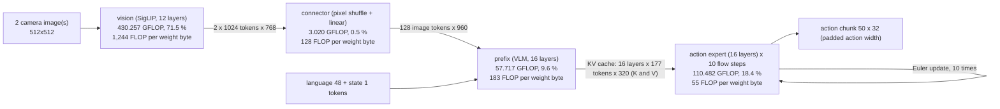

# SmolVLA operator graph: `libero-2cam`

<!-- generated by `python -m workload_modeling.build`; do not edit by hand -->

One SmolVLA policy call on `libero-2cam` (2 camera(s) at 512x512,
48 language tokens, 1 state token; checkpoint `lerobot/smolvla_libero@a24f1f38`),
broken into operator groups with their compute and memory needs. Numbers come from the standalone model
(`infra/workload-modeling/`), which follows the reference computation at true token counts; its
matrix-product FLOP match PR1's compiled programs within 0.011 % per stage once PR1's padding and rewrites
are applied ([crosscheck.md](crosscheck.md)). Label: inference (model output), cross-checked.
Columns and byte rules: [conventions.md](conventions.md). Units and kernels:
[compiler-walkthrough.md](compiler-walkthrough.md).

## Totals

| stage | GFLOP | of which matrix | FLOP share % | unique MB | weight MB | FLOP per weight byte |
| --- | ---: | ---: | ---: | ---: | ---: | ---: |
| vision | 430.257 | 427.618 | 71.5 | 3,843.78 | 345.73 | 1,244 |
| connector | 3.020 | 3.020 | 0.5 | 33.77 | 23.59 | 128 |
| prefix | 57.717 | 57.604 | 9.6 | 568.67 | 314.79 | 183 |
| expert | 110.482 | 110.190 | 18.4 | 2,644.32 | 1,996.99 | 55 |
| **total** | 601.476 | 598.432 | 100.0 | 7,090.54 | 2,681.10 | 224 |

FLOP share by class:

| class | GFLOP | share % |
| --- | ---: | ---: |
| gemm | 512.993 | 85.29 |
| attn | 85.440 | 14.21 |
| softmax | 1.669 | 0.28 |
| norm | 0.385 | 0.06 |
| acti | 0.724 | 0.12 |
| elementwise | 0.267 | 0.04 |
| data | 0.000 | 0.00 |

## vision

SigLIP encoder, run once per camera (reference code); attention per camera and head.

| op | layers | class | shape | count | GFLOP | unique MB | weight MB | FLOP per weight byte | unit today | hand-written kernel | kernel us per call |
| --- | --- | --- | --- | ---: | ---: | ---: | ---: | ---: | --- | --- | ---: |
| `patch_embed` | embed | gemm | M 1024, N 768, K 768 | 2 | 2.416 | 8.65 | 2.36 | 1,024 | RedMulE (operands moved by iDMA) | SummaGEMM | 88.88 |
| `bias_patch` | embed | elementwise | 1024 x 768 | 2 | 0.002 | 6.29 | 0.00 | 512 | Snitch cores | Eltwise (bias) | 19.05 |
| `pos_embed_add` | embed | elementwise | 1024 x 768 | 2 | 0.002 | 9.44 | 3.15 | 0 | Snitch cores | Eltwise (add) | 26.14 |
| `ln1` | 0-11 | norm | 1024 x 768 | 24 | 0.151 | 75.57 | 0.07 | 2,048 | Snitch cores | LayerNorm | 21.25 |
| `q_proj` | 0-11 | gemm | M 1024, N 768, K 768 | 24 | 28.991 | 103.81 | 28.31 | 1,024 | RedMulE (operands moved by iDMA) | SummaGEMM | 88.88 |
| `bias_q` | 0-11 | elementwise | 1024 x 768 | 24 | 0.019 | 75.53 | 0.04 | 512 | Snitch cores | Eltwise (bias) | 19.05 |
| `k_proj` | 0-11 | gemm | M 1024, N 768, K 768 | 24 | 28.991 | 103.81 | 28.31 | 1,024 | RedMulE (operands moved by iDMA) | SummaGEMM | 88.88 |
| `bias_k` | 0-11 | elementwise | 1024 x 768 | 24 | 0.019 | 75.53 | 0.04 | 512 | Snitch cores | Eltwise (bias) | 19.05 |
| `v_proj` | 0-11 | gemm | M 1024, N 768, K 768 | 24 | 28.991 | 103.81 | 28.31 | 1,024 | RedMulE (operands moved by iDMA) | SummaGEMM | 88.88 |
| `bias_v` | 0-11 | elementwise | 1024 x 768 | 24 | 0.019 | 75.53 | 0.04 | 512 | Snitch cores | Eltwise (bias) | 19.05 |
| `transpose_k` | 0-11 | data | 1024 x 768 | 24 | 0.000 | 75.50 | 0.00 |  | Snitch cores and iDMA | FlatAttention (K transposed on chip by the transpose engine) | in `qk` |
| `qk` | 0-11 | attn | h 12, Sq 1024, Skv 1024, d 64 | 24 | 38.655 | 75.50 | 0.00 |  | RedMulE | FlatAttention | 264.51 |
| `softmax` | 0-11 | softmax | 12288 x 1024 | 24 | 1.510 | 1,207.96 | 0.00 |  | Snitch cores | FlatAttention (softmax on Spatz, inside the kernel) | in `qk` |
| `pv` | 0-11 | attn | h 12, Sq 1024, Skv 1024, d 64 | 24 | 38.655 | 75.50 | 0.00 |  | RedMulE | FlatAttention | in `qk` |
| `o_proj` | 0-11 | gemm | M 1024, N 768, K 768 | 24 | 28.991 | 103.81 | 28.31 | 1,024 | RedMulE (operands moved by iDMA) | SummaGEMM | 88.88 |
| `bias_o` | 0-11 | elementwise | 1024 x 768 | 24 | 0.019 | 75.53 | 0.04 | 512 | Snitch cores | Eltwise (bias) | 19.05 |
| `residual_attn` | 0-11 | elementwise | 1024 x 768 | 24 | 0.019 | 113.25 | 0.00 |  | Snitch cores | Eltwise (add) | 26.14 |
| `ln2` | 0-11 | norm | 1024 x 768 | 24 | 0.151 | 75.57 | 0.07 | 2,048 | Snitch cores | LayerNorm | 21.25 |
| `mlp_up` | 0-11 | gemm | M 1024, N 3072, K 768 | 24 | 115.964 | 301.99 | 113.25 | 1,024 | RedMulE (operands moved by iDMA) | SummaGEMM | 323.92 |
| `bias_up` | 0-11 | elementwise | 1024 x 3072 | 24 | 0.075 | 302.14 | 0.15 | 512 | Snitch cores | Eltwise (bias) | 57.70 |
| `gelu` | 0-11 | acti | 1024 x 3072 | 24 | 0.604 | 301.99 | 0.00 |  | Snitch cores | Activation (GELU, tanh form) | 70.52 |
| `mlp_down` | 0-11 | gemm | M 1024, N 768, K 3072 | 24 | 115.964 | 301.99 | 113.25 | 1,024 | RedMulE (operands moved by iDMA) | SummaGEMM | 333.05 |
| `bias_down` | 0-11 | elementwise | 1024 x 768 | 24 | 0.019 | 75.53 | 0.04 | 512 | Snitch cores | Eltwise (bias) | 19.05 |
| `residual_mlp` | 0-11 | elementwise | 1024 x 768 | 24 | 0.019 | 113.25 | 0.00 |  | Snitch cores | Eltwise (add) | 26.14 |
| `ln_post` | post | norm | 1024 x 768 | 2 | 0.013 | 6.30 | 0.01 | 2,048 | Snitch cores | LayerNorm | 21.25 |

## connector

Pixel shuffle (scale factor 4: 16 patches into one token) and one linear projection to the VLM width.

| op | layers | class | shape | count | GFLOP | unique MB | weight MB | FLOP per weight byte | unit today | hand-written kernel | kernel us per call |
| --- | --- | --- | --- | ---: | ---: | ---: | ---: | ---: | --- | --- | ---: |
| `pixel_shuffle` | - | data | 2048 x 768 | 1 | 0.000 | 6.29 | 0.00 |  | Snitch cores and iDMA | Eltwise (pixel_shuffle, DMA only) | 21.11 |
| `connector_proj` | - | gemm | M 128, N 960, K 12288 | 1 | 3.020 | 26.98 | 23.59 | 128 | RedMulE (operands moved by iDMA) | SummaGEMM | 219.65 |
| `embed_scale` | - | elementwise | 128 x 960 | 1 | 0.000 | 0.49 | 0.00 |  | Snitch cores | Eltwise (scale) | 2.35 |

## prefix

Image, language and state tokens through the kept VLM layers, once per call; the per-layer keys and values are kept as the KV cache the expert reads.

| op | layers | class | shape | count | GFLOP | unique MB | weight MB | FLOP per weight byte | unit today | hand-written kernel | kernel us per call |
| --- | --- | --- | --- | ---: | ---: | ---: | ---: | ---: | --- | --- | ---: |
| `lang_embed_scale` | embed | elementwise | 48 x 960 | 1 | 0.000 | 0.28 | 0.09 | 0 | host (PR1 prepare step) | none |  |
| `state_proj` | embed | gemm | M 1, N 960, K 32 | 1 | 0.000 | 0.06 | 0.06 | 1 | host (PR1 prepare step) | none |  |
| `bias_state` | embed | elementwise | 1 x 960 | 1 | 0.000 | 0.01 | 0.00 | 0 | host (PR1 prepare step) | none |  |
| `rmsnorm_attn` | 0-15 | norm | 177 x 960 | 16 | 0.011 | 10.91 | 0.03 | 354 | Snitch cores | RMSNorm | 8.52 |
| `q_proj` | 0-15 | gemm | M 177, N 960, K 960 | 16 | 5.220 | 40.37 | 29.49 | 177 | RedMulE (operands moved by iDMA) | SummaGEMM | 39.48 |
| `k_proj` | 0-15 | gemm | M 177, N 320, K 960 | 16 | 1.740 | 17.08 | 9.83 | 177 | RedMulE (operands moved by iDMA) | SummaGEMM | 20.94 |
| `v_proj` | 0-15 | gemm | M 177, N 320, K 960 | 16 | 1.740 | 17.08 | 9.83 | 177 | RedMulE (operands moved by iDMA) | SummaGEMM | 20.94 |
| `rope_q` | 0-15 | elementwise | 177 x 960 | 16 | 0.008 | 10.87 | 0.00 |  | Snitch cores | Eltwise (rope) | 3.57 |
| `rope_k` | 0-15 | elementwise | 177 x 320 | 16 | 0.003 | 3.62 | 0.00 |  | Snitch cores | Eltwise (rope) | 2.58 |
| `qk` | 0-15 | attn | h 15, Sq 177, Skv 177, d 64 | 16 | 0.962 | 7.25 | 0.00 |  | RedMulE | FlatAttention; masking not supported | 55.75 |
| `softmax` | 0-15 | softmax | 2655 x 177 | 16 | 0.038 | 30.08 | 0.00 |  | Snitch cores | FlatAttention (softmax on Spatz, inside the kernel) | in `qk` |
| `pv` | 0-15 | attn | h 15, Sq 177, Skv 177, d 64 | 16 | 0.962 | 7.25 | 0.00 |  | RedMulE | FlatAttention; masking not supported | in `qk` |
| `o_proj` | 0-15 | gemm | M 177, N 960, K 960 | 16 | 5.220 | 40.37 | 29.49 | 177 | RedMulE (operands moved by iDMA) | SummaGEMM | 39.48 |
| `residual_attn` | 0-15 | elementwise | 177 x 960 | 16 | 0.003 | 16.31 | 0.00 |  | Snitch cores | Eltwise (add) | 5.21 |
| `rmsnorm_mlp` | 0-15 | norm | 177 x 960 | 16 | 0.011 | 10.91 | 0.03 | 354 | Snitch cores | RMSNorm | 8.52 |
| `mlp_gate` | 0-15 | gemm | M 177, N 2560, K 960 | 16 | 13.920 | 98.58 | 78.64 | 177 | RedMulE (operands moved by iDMA) | SummaGEMM | 100.69 |
| `mlp_up` | 0-15 | gemm | M 177, N 2560, K 960 | 16 | 13.920 | 98.58 | 78.64 | 177 | RedMulE (operands moved by iDMA) | SummaGEMM | 100.69 |
| `silu_mul` | 0-15 | acti | 177 x 2560 | 16 | 0.036 | 43.50 | 0.00 |  | Snitch cores | Activation (SiLU + gate) | 17.26 |
| `mlp_down` | 0-15 | gemm | M 177, N 960, K 2560 | 16 | 13.920 | 98.58 | 78.64 | 177 | RedMulE (operands moved by iDMA) | SummaGEMM | 92.23 |
| `residual_mlp` | 0-15 | elementwise | 177 x 960 | 16 | 0.003 | 16.31 | 0.00 |  | Snitch cores | Eltwise (add) | 5.21 |
| `rmsnorm_final` | tail | norm | 177 x 960 | 1 | 0.001 | 0.68 | 0.00 | 354 | Snitch cores | RMSNorm | 8.52 |

## expert

Flow-matching transformer run once per flow step. Even layers: self-attention over the prefix cache and the action tokens; odd layers: cross-attention to the projected prefix cache. The reference code repeats the cross-attention K/V projection in every step.

| op | layers | class | shape | count | GFLOP | unique MB | weight MB | FLOP per weight byte | unit today | hand-written kernel | kernel us per call |
| --- | --- | --- | --- | ---: | ---: | ---: | ---: | ---: | --- | --- | ---: |
| `cross_k_proj` | cross (1,3..15) | gemm | M 177, N 320, K 320 | 80 | 2.900 | 34.51 | 16.38 | 177 | RedMulE (operands moved by iDMA) | SummaGEMM | 9.76 |
| `cross_v_proj` | cross (1,3..15) | gemm | M 177, N 320, K 320 | 80 | 2.900 | 34.51 | 16.38 | 177 | RedMulE (operands moved by iDMA) | SummaGEMM | 9.76 |
| `action_in_proj` | embed | gemm | M 50, N 720, K 32 | 10 | 0.023 | 1.21 | 0.46 | 50 | RedMulE (operands moved by iDMA) | SummaGEMM | 2.63 |
| `bias_action_in` | embed | elementwise | 50 x 720 | 10 | 0.000 | 1.45 | 0.01 | 25 | Snitch cores | Eltwise (bias) | 1.50 |
| `time_mlp_in` | embed | gemm | M 50, N 720, K 1440 | 10 | 1.037 | 22.90 | 20.74 | 50 | RedMulE (operands moved by iDMA) | SummaGEMM | 30.15 |
| `bias_time_in` | embed | elementwise | 50 x 720 | 10 | 0.000 | 1.45 | 0.01 | 25 | Snitch cores | Eltwise (bias) | 1.50 |
| `time_silu` | embed | acti | 50 x 720 | 10 | 0.001 | 1.44 | 0.00 |  | Snitch cores | Activation (SiLU) | 1.46 |
| `time_mlp_out` | embed | gemm | M 50, N 720, K 720 | 10 | 0.518 | 11.81 | 10.37 | 50 | RedMulE (operands moved by iDMA) | SummaGEMM | 16.87 |
| `bias_time_out` | embed | elementwise | 50 x 720 | 10 | 0.000 | 1.45 | 0.01 | 25 | Snitch cores | Eltwise (bias) | 1.50 |
| `rmsnorm_attn` | 0-15 | norm | 50 x 720 | 160 | 0.023 | 23.27 | 0.23 | 100 | Snitch cores | RMSNorm | 2.33 |
| `qkv_proj` | self (0,2..14) | gemm | M 50, N 1600, K 720 | 80 | 9.216 | 202.88 | 184.32 | 50 | RedMulE (operands moved by iDMA) | SummaGEMM | 34.14 |
| `q_proj` | cross (1,3..15) | gemm | M 50, N 960, K 720 | 80 | 5.530 | 124.03 | 110.59 | 50 | RedMulE (operands moved by iDMA) | SummaGEMM | 16.87 |
| `rope_q` | 0-15 | elementwise | 50 x 960 | 160 | 0.023 | 30.72 | 0.00 |  | Snitch cores | Eltwise (rope) | 1.44 |
| `rope_k` | self (0,2..14) | elementwise | 50 x 320 | 80 | 0.004 | 5.12 | 0.00 |  | Snitch cores | Eltwise (rope) | 0.94 |
| `self_qk` | self (0,2..14) | attn | h 15, Sq 50, Skv 227, d 64 | 80 | 1.743 | 19.30 | 0.00 |  | RedMulE | FlatAttention; masking not supported | 19.81 |
| `self_pv` | self (0,2..14) | attn | h 15, Sq 50, Skv 227, d 64 | 80 | 1.743 | 19.30 | 0.00 |  | RedMulE | FlatAttention; masking not supported | in `self_qk` |
| `self_softmax` | self (0,2..14) | softmax | 750 x 227 | 80 | 0.068 | 54.48 | 0.00 |  | Snitch cores | FlatAttention (softmax on Spatz, inside the kernel) | in `self_qk` |
| `cross_qk` | cross (1,3..15) | attn | h 15, Sq 50, Skv 177, d 64 | 80 | 1.359 | 16.74 | 0.00 |  | RedMulE | FlatAttention; masking not supported | 19.10 |
| `cross_pv` | cross (1,3..15) | attn | h 15, Sq 50, Skv 177, d 64 | 80 | 1.359 | 16.74 | 0.00 |  | RedMulE | FlatAttention; masking not supported | in `cross_qk` |
| `cross_softmax` | cross (1,3..15) | softmax | 750 x 177 | 80 | 0.053 | 42.48 | 0.00 |  | Snitch cores | FlatAttention (softmax on Spatz, inside the kernel) | in `cross_qk` |
| `o_proj` | 0-15 | gemm | M 50, N 720, K 960 | 160 | 11.059 | 248.06 | 221.18 | 50 | RedMulE (operands moved by iDMA) | SummaGEMM | 21.37 |
| `residual_attn` | 0-15 | elementwise | 50 x 720 | 160 | 0.006 | 34.56 | 0.00 |  | Snitch cores | Eltwise (add) | 1.63 |
| `rmsnorm_mlp` | 0-15 | norm | 50 x 720 | 160 | 0.023 | 23.27 | 0.23 | 100 | Snitch cores | RMSNorm | 2.33 |
| `mlp_gateup` | 0-15 | gemm | M 50, N 4096, K 720 | 160 | 47.186 | 1,020.77 | 943.72 | 50 | RedMulE (operands moved by iDMA) | SummaGEMM | 67.22 |
| `silu_mul` | 0-15 | acti | 50 x 2048 | 160 | 0.082 | 98.30 | 0.00 |  | Snitch cores | Activation (SiLU + gate) | 4.12 |
| `mlp_down` | 0-15 | gemm | M 50, N 720, K 2048 | 160 | 23.593 | 516.15 | 471.86 | 50 | RedMulE (operands moved by iDMA) | SummaGEMM | 38.79 |
| `residual_mlp` | 0-15 | elementwise | 50 x 720 | 160 | 0.006 | 34.56 | 0.00 |  | Snitch cores | Eltwise (add) | 1.63 |
| `rmsnorm_final` | out | norm | 50 x 720 | 10 | 0.001 | 1.45 | 0.01 | 100 | Snitch cores | RMSNorm | 2.33 |
| `action_out_proj` | out | gemm | M 50, N 32, K 720 | 10 | 0.023 | 1.21 | 0.46 | 50 | RedMulE (operands moved by iDMA) | SummaGEMM | 5.67 |
| `bias_action_out` | out | elementwise | 50 x 32 | 10 | 0.000 | 0.06 | 0.00 | 25 | Snitch cores | Eltwise (bias) | 0.70 |
| `euler_update` | out | elementwise | 50 x 32 | 10 | 0.000 | 0.10 | 0.00 |  | Snitch cores | Eltwise (axpy) | 0.72 |

## Composed estimate from hand-written kernels

"kernel us per call" is the operator's hand-written kernel simulated alone at one instance of the operator:
kernel repo `HaozeG/gvsoc@580ac85 (branch gelu-layernorm-kernels)`, stage-1 arch (16 clusters, RedMulE 32 x 16 and Spatz on 4 cores per cluster),
DRAMSys HBM. Label: measured per call. Values, tile settings and sources: `constants.yaml` section
`hand_kernels`. "in `qk`" marks work done inside that row's kernel call: FlatAttention runs QK^T, softmax and
P.V in one call and transposes K on chip.

Hardware the kernels ran on: the kernel repo's arch file (`constants.yaml` section `arch.stage1`). Read from
the arch file: measured; totals computed from it: inference.

| part | setting |
| --- | --- |
| mesh | 4 x 4 = 16 clusters at 1 GHz |
| cluster | 5 Snitch cores: 4 with a Spatz vector unit (4 FPUs, VLEN 16384 bit), one data-mover core driving the iDMA |
| matrix unit | RedMulE 32 x 16 CE per cluster, fp16: 1.024 TFLOP/s per cluster, 16.4 TFLOP/s in total |
| L1 (TCDM) | 384 KiB per cluster, 6 MiB in total |
| NoC | 1024-bit links |
| HBM | 8 channels on the west and east edges, DRAMSys model (JEDEC HBM2E-4000, 64-bit, 2000 MHz, DDR); 64 GB/s per channel, 512 GB/s in total (inference: from DRAMSys's utilization report; the memspec alone gives half) |
| balance | peak / HBM bandwidth = 32 FLOP per byte: an operator below this FLOP per byte of HBM traffic is bandwidth-bound here |

| kernel | operators | output checked | how it was run |
| --- | --- | --- | --- |
| SummaGEMM | every matrix product | no (upstream preload: placeholder data) | M, N, K padded up to 4 x tile; tiles: fastest of a sweep per shape |
| FlatAttention | QK^T, softmax, P.V | no (upstream preload: placeholder data) | no masking (prefix and expert need one: approximation); GQA folds query heads; blocks: fastest of a sweep; sequence lengths padded up to a block multiple |
| LayerNorm, Activation, Eltwise | norms, activations, elementwise, pixel shuffle | yes, bit-exact against a replay golden | one row per cluster at a time |
| RMSNorm | RMSNorm | no (upstream kernel, placeholder data) | upstream settings |

SummaGEMM and FlatAttention outputs are not checked. As a check that a picked setting did its whole problem, its
DRAMSys traffic was compared with the minimum the padded problem must move (operands read once, output written
once): every pick moves 1.0 to 3.2 times that minimum. A smaller GEMM shape is never slower than a larger one
that contains it.

The composed time is the sum over operators of count x time per call. Label: estimate. It assumes kernels
run back to back with nothing between them: no overlap, no layout change between kernels (the projections write
token-major rows, FlatAttention reads head-major Q, K, V), and every kernel starting and ending in HBM.
It is on the stage-1 arch with DRAMSys HBM, not PR1's arch with ideal HBM. Per-call times move by about 3 %
with code placement alone (GELU: 68.1 to 70.5 us for the same loop at a 12-byte offset, mechanism not
identified).

| stage | GEMM, us | attention, us | row operators, us | total, us | inside another call | not covered |
| --- | ---: | ---: | ---: | ---: | --- | --- |
| vision | 24,477.6 | 6,348.3 | 7,770.7 | 38,596.6 | `transpose_k` (in `qk`), `softmax` (in `qk`), `pv` (in `qk`) | none |
| connector | 219.6 | 0.0 | 23.5 | 243.1 | none | none |
| prefix | 6,631.1 | 892.0 | 822.6 | 8,345.7 | `softmax` (in `qk`), `pv` (in `qk`) | `lang_embed_scale` (host), `state_proj` (host), `bias_state` (host) |
| expert | 26,575.9 | 3,112.9 | 2,329.3 | 32,018.1 | `self_pv` (in `self_qk`), `self_softmax` (in `self_qk`), `cross_pv` (in `cross_qk`), `cross_softmax` (in `cross_qk`) | none |
| **all** | 57,904.2 | 10,353.2 | 10,946.0 | **79,203.4** | | |

Total: 79.20 ms per inference call (estimate); shares: GEMM 73 %, attention
13 %, row operators 14 %.

## Limitations

* **No tiling re-reads.** Bytes count each operand once per operator instance; re-reads caused by tiling
  (for example the M = 50 expert products re-reading X per column tile in PR1) are left to the measurement work.
* **Weightless operators have no intensity.** Attention, softmax and activations have no weight bytes; their
  cost on SoftHier is set by core issue rate and data movement, not by this column.
* **Weights re-read per flow step.** The expert's weights (about 200 MB per step) do not fit on chip, so the
  model reads them in every step; keeping tiles on chip is RQ2.
* **Vision per camera.** As in the reference code, the encoder runs once per camera and reads its weights each
  time; batching the cameras would halve vision's weight bytes for two cameras.
* **Per-element FLOP for non-matrix classes are conventions** (inference), small next to the matrix products.
