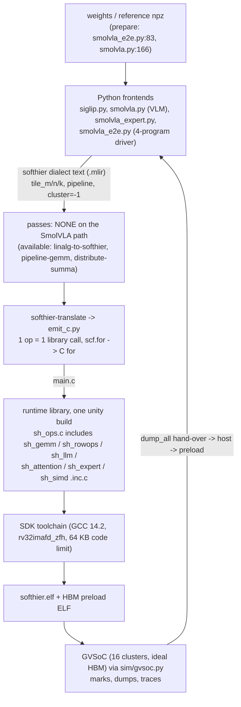

# COMPILER: how softhier-mlir maps SmolVLA onto SoftHier, and why the profile looks the way it does

Step PROF.2 (LOG.md). Reading-only companion to [PROFILE.md](PROFILE.md): no simulator was run, softhier-mlir and its patches were not changed. The only host-side check was a static look at an already built `softhier.dump` (disassembly) of the prefix program.

**Which tree the file:line references point to.** `experiments/smolvla-e2e-baseline/softhier-mlir/` at `b11cd5f` plus `patches/0001` to `0006` as checked out (patch 0006 only touches `frontend/siglip.py` and `testing/siglip_ref.py`). Paths below are relative to that directory unless they start with `third_party/` (the pinned GVSoC). Line numbers are for that tree.

**Labels.** Same as PROFILE.md: *measured*, *derived*, *estimate*. Each cause in section 5 is additionally *confirmed* (code evidence and profile agree) or *hypothesis*. Savings are rough estimates computed from profile shares; they overlap and must not be added up (see the ranking).

## Structure

1. [Overview](#1-overview)
2. [Architecture](#2-architecture): pipeline, stage by stage (files, decisions, non-decisions)
3. [Execution model on the hardware](#3-execution-model-on-the-hardware)
4. [How each SmolVLA op class is lowered](#4-how-each-smolvla-op-class-is-lowered)
5. [Why it is slow: the intuitive picture](#5-why-it-is-slow-the-intuitive-picture)
6. [Pointers](#6-pointers)

## 1. Overview

softhier-mlir is a small compiler plus a hand-written operator library for the SoftHier many-cluster accelerator (4 x 4 clusters; per cluster 3 Snitch cores, one RedMulE matrix engine, one iDMA, 1 MB of TCDM scratchpad; HBM on the mesh edges), simulated in GVSoC. It is built on xDSL (Python MLIR):

- **Python frontends** (`softhier_mlir/frontend/`) walk the model structure (SigLIP vision tower, SmolVLM text tower, action expert) and write a program in the **`softhier` dialect** (`softhier_mlir/dialects/softhier.py`): one op per library-level operation (`softhier.gemm`, `layernorm`, `softmax`, `attention`, `rmsnorm`, `rope`, `silu_mul`, ...), HBM buffers as `memref`s with byte offsets, and `scf.for` loops for layers, heads and flow steps. Tile sizes and `pipeline` / `cluster = -1` are attached to the ops by the frontend.
- **Passes** exist (`linalg-to-softhier`, `pipeline-gemm`, `distribute-summa`) but are tiny attribute setters; **the SmolVLA path runs none of them** (the e2e driver calls `lower_and_translate(..., None)`, `tests/gvsoc/run.py:600`).
- **`emit_c`** (`softhier_mlir/backend/emit_c.py`) turns each op into exactly one C call into the **runtime library** (`runtime/sh_*.inc.c`, one translation unit). There is no code generation of kernels: every kernel is hand-written C with inline fp16-SIMD assembly.
- The library calls are **SPMD**: every core of every cluster runs the same `main`, and each call splits its own work over clusters and cores and ends with a global barrier.
- The **GVSoC driver** (`softhier_mlir/sim/gvsoc.py`, `tests/gvsoc/run.py`) builds the ELF with the SDK toolchain, preloads weights through an HBM image, runs the simulator and reads marks and dumps.

**What it produces for SmolVLA:** 4 programs, because the fp16 weights (674 MiB) do not fit the 512 MiB of HBM at once: `vision` (SigLIP 12 layers + pixel shuffle + connector GEMM) -> `prefix_a` (text layers 1 to 8, writes KV cache) -> `prefix_b` (layers 9 to 16) -> `expert` (KV projection + 10 flow steps, reads the KV cache). The host dumps each phase's hand-over state (`softhier.dump_all`) and preloads it into the next program (`docs/SMOLVLA_E2E.md` section 2). Together they are 2 890 timed library calls, each followed by a global barrier.

**One-sentence picture.** The compiler is a thin dispatcher: the intelligence (tiling, buffering, fusion, overlap) lives at the granularity of one library call, every call reads its inputs from HBM and writes its outputs back to HBM, and everything that is not a matrix multiply runs on three small cores that are limited by instruction fetch. The profile (1.2 % of RedMulE peak, 64.5 % of the time in core-executed ops) follows from that structure.

## 2. Architecture



The SmolVLA e2e path is therefore: `frontend -> .mlir text -> softhier-translate (no softhier-opt) -> C -> ELF -> GVSoC`. The three phase hand-overs go through the host.

| stage | key files | decisions it makes | what it does NOT do |
| --- | --- | --- | --- |
| Frontends | `frontend/siglip.py` (vision, `gemm_tile_attrs` :54, `fused_attention` flag :77), `frontend/smolvla.py` (text tower `emit_vlm` :768, `VLM_TILES` :764), `frontend/smolvla_expert.py` (`emit_flow` :666, `TILES` :388), `frontend/smolvla_e2e.py` (`emit_vision` :128, 4-program driver) | op sequence per layer; HBM layout (weights at a constant per-layer stride, `scf.for` over layers/heads/steps to fit the 64 KB code memory); tile shapes; which library variant (`attn="stream"`, `gemm="tiles"` by default, :670); per-head vs fused attention (per-head by default in vision) | no fusion across ops; no cross-op scheduling; no data placement in L1 between ops; no choice among HBM nodes except the west/south split by layer |
| Tile policy | `dse/tiling.py:47` `gemm_tiles` (analytic cost model `dse/cost.py`); used only by the vision frontend (`siglip.py:58-60`). Prefix and expert use hard-coded tables (`VLM_TILES`, `TILES`) | the cheapest `(tm, tn, tk)` that fits TCDM under a model of "GEMMs are HBM-bound" | no split-K, no multicast-aware cost, no per-shape cluster count (all output tiles are dealt round-robin) |
| Dialect | `dialects/softhier.py` (~850 lines, ~50 ops) | ops are library-call shaped (e.g. `softhier.cross_attention`), not tensor-algebra shaped | no `linalg`/`mesh` structure on this path, so nothing for generic passes to rewrite |
| Passes | `transforms/linalg_to_softhier.py` (67 lines, lowers `linalg.matmul` to `softhier.gemm`), `transforms/pipeline_gemm.py` (32, sets a `pipeline` unit attribute), `transforms/distribute_summa.py` (30, sets `summa`), driver `tools/softhier_opt.py` | only used by the small `examples/*.mlir` | **not run for SmolVLA**: the frontends already write `pipeline` and `cluster = -1` into the op text (e.g. `smolvla_e2e.py:203`). The three "decide" passes are attribute setters, the real decisions are in the frontends and `dse/tiling.py` |
| Backend | `backend/emit_c.py` (716 lines): `GemmOp` -> `sh_gemm` / `sh_gemm_mesh` (`summa`) / `sh_gemm_xmcast_ex` (`xmcast`), :327-342; config struct incl. `accumulate`, :263-270; `group_barrier` -> `sh_barrier_global`, :592 | maps attributes to library arguments; scf/arith to C | no scheduling, no buffer allocation (all buffers are HBM buffers with frontend-chosen offsets), no fusion |
| Runtime library | `runtime/sh_gemm.inc.c` (344 lines), `sh_rowops.inc.c` (465), `sh_llm.inc.c` (362), `sh_attention.inc.c` (243), `sh_expert.inc.c` (281), `sh_simd.inc.c` (110), `sh_rt.inc.c` (121), `sh_flow.inc.c` (381) | all the real work: tile dealing, double buffering, work split over clusters and cores, fp16 SIMD kernels, barriers | does not look at neighbouring ops; every call is self-contained |
| Driver | `sim/gvsoc.py`, `tests/gvsoc/run.py`, `sim/preload.py` | build, preload image (weights), run, parse marks | not part of the compiled program |

**Things the repo documents but the SmolVLA path does not use** (checked, because they matter for the "what a better compiler would do" column): split-K is claimed in `README.md:30` but does not exist (`sh_gemm.inc.c:78-80` deals output tiles only; `docs/SMOLVLA_E2E.md:108` says so; the README line is stale). `DESIGN.md` describes a `mesh`-dialect / Spatz-`vexp` pipeline; it is aspirational: the arch has `spatz_attaced_core_list = []` (`arch/softhier_mlir_arch.py:24`) and the toolchain is built without the `v` extension (`sim/gvsoc.py:137`). The library does contain a mesh SUMMA GEMM (`sh_gemm.inc.c:127`, needs M = N = P*T), an X-panel multicast GEMM (`:192-343`, `softhier.gemm {xmcast}`), a fused attention (`sh_attention.inc.c:219`) and a KV-stationary expert attention with NoC gather (`sh_flow.inc.c:1-16`); none of them is selected by the e2e emitters (the profile's `c2c = 0` is the visible symptom).

## 3. Execution model on the hardware

Per cluster (arch file `arch/softhier_mlir_arch.py`): 3 Snitch cores, RedMulE (128 x 32 CEs, 4096 MAC/cycle), iDMA, 1 MB TCDM (`cluster_tcdm_size = 0x100000`), 64 KB instruction memory shared by all clusters' code (`instruction_mem_size = 0x10000`). 16 clusters at 1 GHz; HBM on the west and south edges, NoC link 512 bit.

**Who does what** (derived from the library):

- **core 0 ("first core", `flex_is_first_core()`)** configures and triggers RedMulE and blocks on it: `flex_redmule_trigger` then `flex_redmule_wait` (`sh_gemm.inc.c:99`). In GEMMs it does nothing else.
- **DM core (`flex_is_dm_core()`, pe2 in the PROFILE traces)** issues every iDMA transfer: tile loads, prefetch, stores, TCDM zeroing from the ZOMEM region (`sh_gemm.inc.c:33-40`), and polls for completion (`bare_dma_wait_all`).
- **Row-ops and softmax: all three cores compute**, the DM core included (`sh_rowops.inc.c:2-4`, `sh_share` :31). In these ops the iDMA is a background streamer.
- **TCDM is a software-managed scratchpad**: each library call carves its own layout from a fixed base (GEMM: `X0 | X1 | W0 | W1 | Y` from `l1_base`, `sh_gemm.inc.c:8`; row-ops: a 512 KB staging window at `0x1000`, `sh_rowops.inc.c:13-14`; attention: q, k, k^T, scores, v, o, `sh_attention.inc.c:8`). **Nothing survives between library calls**: the next call re-stages whatever it needs from HBM.
- **HBM layout**: every activation is an HBM buffer with a fixed offset (`softhier.hbm_buffer {offset}` in the `.mlir`; vision: `x, ln1, q, k, v, kT, sc, o, ao, h, ln2, f1, g, f2, ...`). Weights are preloaded at a constant per-layer stride. All buffers are declared `"hbm_west"`; the text-tower weights that do not fit the first 256 MiB go to the south edge (`smolvla.py:775`).
- **Barrier discipline.** Each library call called with `cluster = SH_ALL` (`-1` in the dialect) splits its work over the 16 clusters and ends with `flex_global_barrier_xy()`: GEMM `sh_gemm.inc.c:115`, row-ops `sh_end_op` `sh_rowops.inc.c:22-25`, fused attention `sh_attention.inc.c:233`, expert attention `sh_expert.inc.c:261`. (`softhier.group_barrier`, `emit_c.py:592`, is an extra one used once per vision layer.) The barrier is an intra-cluster sync, then an AMO fetch-add by the DM core on two barrier words and a wake-up (`third_party/gvsoc/soft_hier/flex_cluster_sdk/runtime/include/flex_runtime.h:297-326`). Empty-barrier latency is 244 to 266 cycles (calibrated in `docs/DSE.md` section 3).

**One expert layer on the chip (timeline sketch, not to scale; derived from PROFILE step-5 layer 6, 489 us).** `|` is a global barrier; the lanes are what the resource is doing across the 16 clusters.

```
time -->  | rmsnorm | qkv GEMM | rope | self/cross attention (15 heads)| o GEMM| res |rmsnorm| gate|up GEMM | silu*up |  down GEMM | res |
cores     |#########|..........|######|##########################.....|.......|#####|#######|................|#########|............|#####|
RedMulE   |.........|=.........|......|..=..............=............|=......|.....|.......|=...............|.........|=...........|.....|
iDMA      |.........|##########|......|####....................######.|#######|.....|.......|################|.........|############|.....|
          |  26 us  |   36 us  | 16us |          131 us               | 36 us | 5us | 25 us |     63 us      |  78 us  |    59 us   | 5us |
          # = busy (> 50 %)  = = RedMulE busy 10-15 % of the window  . = idle/waiting
```

Reading: the GEMM windows are iDMA-bound (weights stream in; RedMulE 10-15 %), the row-op windows are core-bound (cores busy, iDMA and RedMulE idle), and a barrier separates every pair of them. At no point are the engine that is idle in one window and the engine that is busy in the next working at the same time.

## 4. How each SmolVLA op class is lowered

### 4.1 GEMM (`softhier.gemm` -> `sh_gemm`, `runtime/sh_gemm.inc.c:53`)

- **Tile policy.** The frontend sets `tile_m, tile_n, tile_k` per GEMM. Vision: the cost model (`dse/tiling.py:47`), which on the DSE evidence (`docs/DSE.md` section 8: aggregate HBM->TCDM rate out of one HBM node is 85-125 B/cycle whatever the cluster count, so smaller tiles move more bytes and run slower) picks the biggest tiles that fit TCDM. Prefix and expert: fixed tables (`smolvla.py:764` `VLM_TILES`, `smolvla_expert.py:388` `TILES`). `M % tm`, `N % tn`, `K % tk` must be 0 (`sh_gemm.inc.c:60`).
- **Tile -> cluster dealing: round-robin over output tiles**, `((r * NT + col) % P) != cid -> continue` (`sh_gemm.inc.c:80`). One cluster owns a whole output tile and the whole K loop. **There is no split-K and no 2-D cluster tiling beyond this dealing**; the number of busy clusters is `min(16, MT * NT)`.
- **Pipelining.** With `pipeline` and `KT = K / tk > 1` the DM core prefetches K-tile `kk + 1` into the second X/W buffer while core 0 runs RedMulE on tile `kk` (`sh_gemm.inc.c:94-100`). Prologue (Y zero via DMA, load K-tile 0, wait) and epilogue (**synchronous per-row 1-D stores**, one `bare_dma_start_1d` per row, `sh_gemm.inc.c:46-51,112`) are not overlapped with compute. If `tk = K` then `KT = 1`, the `pipeline` flag does nothing, and a tile is zero -> load -> wait -> RedMulE -> store in sequence.
- **Concrete shapes in the published programs** (`~/.cache/softhier-vla/profile/published-fixi-rung6/*.mlir`):

| phase | GEMM (M x N x K) | tile m,n,k | output tiles -> busy clusters | KT |
| --- | --- | --- | --- | --- |
| vision | q/k/v/o 256 x 768 x 768 | 256, 384, 128 | 1 x 2 = 2 | 6 |
| vision | mlp_up 256 x 3072 x 768 | 256, 384, 128 | 8 | 6 |
| vision | mlp_down 256 x 768 x 3072 | 256, 384, 256 | 2 | 12 |
| vision | per-head QK^T 256 x 256 x 64 / P.V 256 x 64 x 256 | 256,256,64 / 256,64,256 | 1 / 1 | 1 / 1 |
| prefix | q/o 128 x 960 x 960 | 128, 192, 320 | 5 | 3 |
| prefix | gate/up 128 x 2560 x 960 | 128, 256, 320 | 10 | 3 |
| prefix | k/v 128 x 320 x 960 | 128, 320, 320 | 1 | 3 |
| expert | qkv 50 x 1600 x 720 | 50, 64, 720 | 25 on 16 clusters (9 clusters do 2, 7 do 1) | 1 |
| expert | q / o 50 x 960 x 720, 50 x 720 x 960 | 50,64,720 / 50,48,960 | 15 / 15 | 1 / 1 |
| expert | gate|up 50 x 4096 x 720 | 50, 256, 240 | 16 | 3 |
| expert | down 50 x 720 x 2048 | 50, 48, 512 | 15 | 4 |

These counts match the profile's `active clusters` column (2 / 8 / 2 / 1 / 5 / 10 / 1 / 16 / 15 / 15 / 16 / 15).

- **Data movement.** X and W tiles come from HBM by 2-D iDMA (`sh_load_block_async`, `sh_gemm.inc.c:43-45`); each output tile re-reads its X row panel, so X crosses HBM once per column tile. For the expert (M = 50, 15 to 25 column tiles) that is the 193 MB of weights per step plus ~120 MB of repeated X (derived: 312 MB GEMM reads per step measured, minus the 193 MB estimate). Nothing is multicast.

### 4.2 Row-ops: LayerNorm, RMSNorm, softmax, GELU, SiLU-mul, RoPE, bias, residual

All go through one driver pattern: `sh_rowop` (`sh_rowops.inc.c:79`), `sh_llm_rowop` (`sh_llm.inc.c`, same shape).

- **Distribution.** Rows are cut into blocks of `rpb` rows, with `rpb` capped at `ceil(rows / 16)` so that every cluster gets a block (`sh_rowops.inc.c:84-87`, `sh_llm.inc.c:32-35`); blocks are dealt round-robin over clusters (`sh_my_block` :18). Inside a block the three cores take contiguous shares (`sh_share` :31). For the expert's 50 rows: `rpb = 4`, 13 blocks, **13 of 16 clusters work**, and 4 rows on 3 cores is a 2/1/1 split.
- **Data movement per call.** The DM core stages a block into TCDM (2-D load), double-buffered (`next` block loads during compute, :122), the cores compute, a core barrier, then **per-row 1-D stores** back to HBM (:131), a final wait (:136) and the global barrier. Parameter rows (gamma, beta, bias) are staged and converted fp16 to fp32 once per call (:102-118): a per-call fill cost.
- **Arithmetic.** Not scalar: since the 2026-10-08 rewrite (`docs/SIMULATOR_NOTES.md`, "Row-wise / elementwise fp16 ops") the kernels are **fp16 SIMD, 4 lanes per instruction** (Snitch Xfvec through `.insn`, `sh_simd.inc.c:5-70`), with a scalar fp32 fallback when `cols % 4 != 0`. LayerNorm `sh_rowops.inc.c:305`, softmax :326, GELU :364; RMSNorm `sh_llm.inc.c:94`, RoPE :130, SiLU-mul :153. **No SSR, no FREP, no Spatz** (grep over `runtime/`: zero hits).
- **exp / sigmoid.** There is no hardware exp. `2^t` is a degree-3 polynomial plus integer-side assembly of `2^k`: 17 instructions per 4 lanes (`sh_v4_exp2`, `sh_simd.inc.c:79-92`; batched x4 in `sh_v4_exp2x4` :94-110 to amortise the FP-to-integer crossing). Every FP-to-integer round trip goes through a per-core TCDM scratch slot with ordering fences (`sh_simd.inc.c:21-41`; reason: SIMULATOR_NOTES #6/#8). Division is a `vfdiv.h` per vector (GELU, SiLU).
- **What the generated loop looks like (derived, static).** Disassembly of `sh_k_silu_mul` in the built prefix program (`~/.cache/softhier-vla/runs/published/prof-prefix-L1/build_prefix_a/softhier.dump`, loop at `0x80004020..0x80004234`): **134 instructions per 16 elements = 8.4 instructions per element**, of which 64 are SIMD arithmetic (`vf*`, as `.insn`), 16 `fld`, 8 `fsd`, 9 `lw` + 8 `sw` (the FP/integer round trip through TCDM), 19 integer address and SWAR ops, 2 `andi` plus 1 `fmv.x.w` (the ordering fences), and a `csrr mhartid` re-read per iteration. Only about half of the loop is arithmetic. No `jal` in the loop (no calls per element).
- **Cost per element (derived).** Expert `silu_mul`: 50 x 2048 elements, 13 busy clusters, 77.9 us -> about 9.5 ns per element per cluster; vision GELU: 256 x 3072 elements over 16 clusters, 485 us -> about 9.9 ns per element per cluster. That is the same order as the static 8.4 instructions per element, i.e. about one instruction per cycle for the cluster, the "cluster is instruction-fetch bound, ~1 instruction per cycle however many cores" claim of `sh_simd.inc.c:10-13` / SIMULATOR_NOTES #7.
- **Fusion: none.** bias, residual, RoPE, SiLU-multiply, scale each are their own call, with their own stage-in, stage-out and barrier. `sh_gemm` supports an `accumulate` mode that initialises Y from Z (`sh_gemm.inc.c:83`) and `emit_c.py:263-270` forwards it, so a residual add could be folded into the o/down projection from the frontend, but the SmolVLA frontends do not use it (they emit `softhier.add`).

### 4.3 Attention

- **Vision (SigLIP, 12 heads, S = 256): per-head and unfused** (`siglip.py` `fused_attention=False` default; the e2e emitter writes the per-head form, `smolvla_e2e.py:227-232`). One layer = `transpose k` + `scf.for` over 12 heads of {`gemm QK^T`, `softmax`, `gemm P.V`}, each its own library call with its own barrier: 36 + 1 serial ops. QK^T (256 x 256 x 64, tile 256,256,64) and P.V (256 x 64 x 256) are **single-tile GEMMs, so one cluster each** (profile: `active clusters 1.0`); the softmax between them spreads its 256 rows over all 16 clusters. The scores `sc` (3072 x 256) live in HBM and are written by QK^T, read and rewritten by softmax, read by P.V: three HBM trips per head. The fused kernel exists and was measured 13 % faster per layer in the dev docs (`docs/DSE.md` 8.3: 2.20 -> 1.92 ms with cost-model tiles, older ISS build); it is not selected.
- **Prefix (`softhier.attention` -> `sh_attention_q`, `sh_attention.inc.c:219`) and expert (`softhier.cross_attention` -> `sh_x_attention`, `sh_expert.inc.c:243`): fused, one head (or q-block) per cluster.** Everything happens inside one cluster's TCDM: DMA stages q, k, v, the K transpose is done by DMA as one 2-D element gather per k^T row (`sh_attention.inc.c:140-142`), then **RedMulE** computes the scores (`:162`), **the three cores** do the masked softmax over the rows (fp16 SIMD, `sh_attn_softmax_row` :83, expert `sh_x_softmax_row` `sh_expert.inc.c:114`), **RedMulE** computes P.V (`:175`), the cores scale by 1/rowsum, the DM core stores. The softmax therefore sits between two RedMulE calls of about 1 us each (derived, PROFILE "Fused attention, derived split": 56 to 66 % of the window is the softmax gap). Expert: head `h` goes to cluster `h % 16` (`sh_expert.inc.c:254-259`), so 15 clusters work, each running all 50 query rows on its 3 cores (rows split `sh_share(R, 1)`, :168). The prefix key set is re-staged from HBM for every head and every step (`attn="stream"`, `smolvla_expert.py:670`).

### 4.4 Data movement ops

- **K transpose (vision)**: `sh_transpose` (`sh_rowops.inc.c:406`): 128 x 128 blocks through TCDM; the transpose itself is one 2-D iDMA gather of 2-byte elements per column (~1 cycle per element); blocks dealt over clusters. 58 us per layer, 0.6 % of the run (PROFILE caveat: possibly over-estimated by 2.3x).
- **Pixel shuffle (connector)**: `sh_pixel_shuffle` (`sh_llm.inc.c:348`): DM-core-only 1-D loads and stores per output token, tokens dealt round-robin; 10 us, negligible.

## 5. Why it is slow: the intuitive picture

Mental model: the chip is a pipeline of three resources per cluster (cores, iDMA, RedMulE) and the compiler runs them **one at a time**. The program is a chain of 2 890 self-contained kernels. Each kernel pulls its inputs out of HBM, uses mostly one of the three resources, pushes its outputs back to HBM and waits for the slowest cluster at a barrier. RedMulE, the only unit that can do real arithmetic quickly, is busy 4.1 % of the time.

All shares are of the total 120.7 ms (published config) unless stated; shares of different rows overlap (a row-op is both "core-bound" and "unfused"). *Status*: **confirmed** = code evidence and profile agree; **hypothesis** = plausible, not tested here. Machine-readable copy: [profile/compiler_causes.csv](profile/compiler_causes.csv).

| id | profile finding (share of total, label) | compiler / runtime cause (evidence) | status | what a better compiler would do | est. saving |
| --- | --- | --- | --- | --- | --- |
| **C1** (a) | Core-executed ops (elementwise 26.3 + attention 25.0 + norm 12.9 = 64.5 %, measured); cores issue 6 to 14 % of cycles; RedMulE 0 to 1.5 % in these ops (measured) | All non-matmul math runs on 3 cores of a cluster that executes about one instruction per cycle in total (no I-cache, one shared 8 B/cycle fetch port: `sh_simd.inc.c:10-13`, SIMULATOR_NOTES #7). Even with fp16 SIMD the loop is 8.4 instructions per element, only ~half arithmetic: software `exp2` of 17 instr per 4 lanes, FP/int crossings through TCDM with fences, per-iteration address math (`sh_simd.inc.c:79-110`; static count above). Measured 9.5 to 9.9 ns per element per cluster. Instruction count and ~1 instr/cycle: **confirmed**. Exact stall mechanism (profile caveat: "not diagnosed"): **hypothesis** (candidates: fetch port, FP-int hand-off, `vfdiv`) | confirmed (cause not isolated) | Cut instructions per element: unroll without per-iteration CSR/address ops, fuse passes (softmax max/exp/sum in one sweep, SiLU and multiply in the GEMM epilogue), cheaper exp (e.g. table or bit-trick), keep x in registers | ~20 % (range 10 to 30): halve the cost of the 64.5 % |
| **C2** (a) | Same ops; no SIMD speed-up beyond 4 lanes | **No FREP, no SSR, no Spatz.** `grep -i "frep\|ssr" runtime/` is empty. GVSoC does instantiate the FPU sequencers and SSR ports (`third_party/gvsoc/soft_hier/flex_cluster/cluster_unit.py:226-240, 392-403`), and `rv32frep.hpp` is in the ISS, so a hardware-loop FP kernel (repeats come from the sequencer buffer, not from instruction fetch) is plausible; whether this build decodes and times FREP/SSR correctly is unverified. Spatz is absent in this arch (`arch/softhier_mlir_arch.py:24`) | hypothesis | Try FREP/SSR for the inner loops (an experiment, not a compiler pass); or add a vector/exp unit to the arch | included in C1 |
| **C3** (a) | Cheap elementwise (bias, residual, add, scale, pad): 7.1 ms = 5.9 %, each 5 to 100 us for a few KB of work (measured per op); RoPE 3.8 ms = 3.1 % | **No GEMM-epilogue fusion**: every bias/residual/RoPE/SiLU-mul is a separate library call with stage-in, stage-out (per-row 1-D stores, `sh_rowops.inc.c:131`), parameter conversion (:102-118) and a barrier. `accumulate` could absorb residual adds (`sh_gemm.inc.c:83`, `emit_c.py:269`) but the frontends do not use it | confirmed | Fuse bias/residual/RoPE into the preceding GEMM's output path (Y still in TCDM); use `accumulate` for residuals | ~5 % (estimate: most of the 7.1 ms plus part of RoPE) |
| **C4** (b) | Vision/prefix GEMMs use 1 to 10 of 16 clusters (2 for 256 x 768 x 768); vision GEMM class 3.8 ms + prefix 5.4 ms + connector 0.3 ms = 7.9 % at 1.1 to 8.7 % of peak (measured) | Output tiles are the only parallelism: `(r*NT+col) % P` (`sh_gemm.inc.c:80`), tile table fixed by the frontend (`siglip.py:58-60`, `smolvla.py:764`). The policy is **deliberate**: `docs/DSE.md` section 8 measured that more tiles are slower because the aggregate HBM->TCDM rate from one HBM node is 85-125 B/cycle and smaller tiles move more bytes (256 x 768 x 768: 2 tiles 32 us vs 12 tiles of 128 x 128 56 us, older ISS build). So the real cause is missing reuse across clusters: no split-K (`README.md:30` is stale; `SMOLVLA_E2E.md:108`), no multicast in these GEMMs (`sh_gemm_mesh` needs M = N = P*T, `sh_gemm.inc.c:134`), all buffers on one HBM edge | confirmed (idle clusters); fix is a **hypothesis** | Split-K with fp32 reduction (also fixes the fp16-accumulation error noted in `SMOLVLA_E2E.md:100-108`), or 2-D cluster tiles with X/W multicast, plus spreading operands over HBM nodes (`docs/DSE.md` "HBM placement": 1.2 to 1.6x on S = 1024 GEMMs) | ~3 % (these GEMMs are 7.9 % and already ~65 % RedMulE-busy on the working clusters) |
| **C5** (c) | Expert GEMMs: 32.9 ms = 27.3 % (measured); iDMA busy 66 to 93 % vs RedMulE 10 to 15 % on the critical cluster; 312 MB HBM read per step (measured) vs ~193 MB of weights (estimate); c2c = 0 | M = 50 is one row tile, so each of 15 to 25 column tiles re-reads the X panel (`sh_gemm.inc.c:86`): ~120 MB of repeated X per step. With `tk = K` (qkv, q, o: tile_k 720/960) there is only one K step, so `pipeline` overlaps nothing: zero, load, wait, RedMulE, synchronous store in sequence (`sh_gemm.inc.c:82-89, 99-100, 112`). qkv has 25 tiles on 16 clusters (2:1 imbalance, 24 % barrier wait). The library has `gemm="xmcast"` (X crosses HBM once, multicast; `sh_gemm.inc.c:192-343`) but `emit_flow` defaults to `gemm="tiles"` (`smolvla_expert.py:670`) | confirmed | Select `xmcast` (dev docs, older config: HBM read -31 % per step, step -6.3 %); choose `tk < K` so loads overlap RedMulE; pick tile counts that are multiples of 16 | ~4 % (transfer of -6 % on the 64 % expert share; ratio from another config) |
| **C6** (c) | Weights re-read every expert step: ~193 MB x 10 steps (estimate from op shapes) | Partly a **capacity floor**: 189.5 MiB of expert weights vs 16 MB of total TCDM, so fp16 weights must stream every step; floor 193 MB at 85 to 125 B/cycle = 1.5 to 2.3 ms per step (15 to 23 ms per run, derived) (`docs/XPANEL_MCAST.md` section 5). The compiler-fixable part is *when* the stream happens, see C7. Weight multicast would not help (each cluster uses its own column slice); fp8 in the DMA path halves bytes but earlier tests gave only -1.4 % step time because the activation cast costs about what the bytes save (`docs/FLOW_DATAFLOW.md` section 2, fp8 step tables) | confirmed (floor) | fp8/int8 weights with a cast in the DMA path; spread each layer's weights over several HBM nodes; (fewer steps is a model change, not a compiler one) | not counted (floor) |
| **C7** (d) | A global barrier after each of 2 890 ops; GEMM windows are iDMA-bound while cores idle, row-op windows are core-bound while iDMA idles (measured, see timeline) | **No overlap between ops.** The next GEMM's weights have no data dependency on the preceding row-op, but every call is fenced by `flex_global_barrier_xy()` (`sh_rowops.inc.c:22-25`, `sh_gemm.inc.c:115`) and re-fills TCDM from scratch. Expert core-bound ops sum to ~45 ms, expert GEMM weight stream to ~21 ms of iDMA-busy time (derived: 32.9 ms x 0.64), so in principle the stream can hide completely | hypothesis (needs TCDM budget: row-op window is 512 KB, a gate/up slice is ~370 KB per cluster) | An async op interface: issue next op's weight prefetch before the current row-op starts; software-pipeline across ops inside a layer | ~10 % (range 5 to 17; upper bound = the hidden stream) |
| **C8** (d) | Barrier wait 21.9 % of cluster-time (measured); 22 to 27 % in expert row-ops and 66 to 78 % in vision/prefix GEMMs | Mostly **load imbalance, not barrier latency**: an empty barrier costs ~0.25 us (`docs/DSE.md` section 3), 2 890 x 0.25 us = 0.7 ms = 0.6 % (derived). Imbalance sources: 50 rows -> `rpb = 4` -> 13 of 16 clusters (`sh_rowops.inc.c:84-87`) = 19 % idle, matching the 22 to 23 % measured wait in expert norm/elementwise ops; 25 qkv tiles on 16 clusters; 2 busy clusters in vision GEMMs (C4) | confirmed | Split elementwise ops by elements (not rows) over all 16 clusters; tile counts that divide by 16 | ~3 % (estimate) |
| **C9** (e) | Attention 25.0 % (30.2 ms); softmax gap 56 to 66 % of fused attention, softmax 26 % of vision (measured/derived); RedMulE 0.4 to 1.5 % in attention | Softmax between two ~1 us RedMulE calls runs on 3 cores per head (C1); expert: one head per cluster, 15 clusters, all 50 rows on one cluster's 3 cores (`sh_expert.inc.c:254-259, 168`); the prefix K/V are re-staged per head and step (`attn="stream"`). Vision: unfused per-head loop, 36 serial calls per layer, QK^T/P.V on 1 cluster each, scores round-trip HBM three times (`smolvla_e2e.py:227-232`); the fused kernel exists but is not used in vision (`siglip.py:77`) | confirmed | Use `fused_attention` in vision (dev docs: layer 2.20 -> 1.92 ms); expert: KV-stationary attention (`attn="kvs"`) cuts attention HBM reads 18 -> 2 MB per step but measured no time gain (+0.6 %, `docs/FLOW_DATAFLOW.md` section 1), because attention is core-bound; a cheaper softmax (C1) is the lever | ~3 % for the vision switch (estimate: 0.28 ms x 12 layers); rest in C1 |
| **C10** (f) | Every op round-trips activations through HBM: HBM traffic outside GEMM = vision 280 of 608 MB (46 %), prefix 102 of 631 MB (16 %), expert 351 of 3 583 MB (10 %) (measured, PROFILE per-class table) | No L1 residency across ops (TCDM is re-carved by every call, `sh_rowops.inc.c:13-14`, `sh_gemm.inc.c:8`); stores are per-row 1-D DMAs, issue-bound at about 22 to 25 cycles per row (`sh_gemm.inc.c:46-51`, `sh_rowops.inc.c:131`; `docs/DSE.md` section 2). Time impact is mostly hidden under core-bound compute (double buffering), so the share of time is smaller than the share of bytes; it shows as iDMA-busy 12 to 39 % in vision elementwise ops | confirmed (bytes); time impact hypothesis | Keep row-op chains (LN, bias, residual) in TCDM between ops; fuse with C3 | ~3 % (overlaps C3) |
| **C11** | Prefix 12.5 % (15.0 ms); FLOPs counted on 128 padded rows for 65 valid tokens | Prefix and expert KV use `S_pad = 128` for a 65-token prefix (`docs/SMOLVLA_E2E.md` section 1); GEMMs and row-ops process all 128 rows (padding rows are kept at 0 by `pad_rows_zero`, `smolvla.py` `emit_vlm`) | confirmed | Row counts from the actual prefix length (65 rounded to 8), masks only where needed | ~3 % (estimate: about half of prefix elementwise + norm time) |

### If you fixed only three things (estimates)

Estimated from the profile shares; the savings are computed on the 120.7 ms total, overlap, and combine sub-additively (Amdahl), so the combined figure is not the sum.

1. **Cut the instruction cost of core-executed math (C1/C2): ~20 % of total.** It is the biggest single block (64.5 % of the time) and its cost per element (8.4 static instructions, ~9.5 ns per element per cluster) is far from what the units could do. Mixed: instruction-level work in the library (fewer instructions per element, fusion of softmax passes) and an experiment with FREP/SSR (hypothesis). Range 10 to 30 %.
2. **Overlap the weight stream with the row-ops (C7), and fix tile counts/imbalance (C8): ~10 % + ~3 %.** The next GEMM's weights are independent of the preceding row-op, GEMM windows are iDMA-bound and row-op windows core-bound, and the expert alone has ~45 ms of core-bound time against ~21 ms of weight stream. Needs an async op interface and a TCDM budget (hypothesis).
3. **Turn on what the library already has (C5, C9): ~7 %.** `gemm="xmcast"` for the expert and prefix GEMMs (~4 %, ratio transferred from the dev docs) and `fused_attention` for vision (~3 %). Zero new kernels, an emitter-level change. Fusing bias/residual into GEMM epilogues (C3, ~5 %) comes next.

Combined (sequential, estimate): 1 - 0.80 x 0.87 x 0.93 = ~35 % less time (about 1.5x), range 20 to 45 %. The remaining gap to the 131 TFLOP/s peak is structural: M = 50 expert GEMMs stay weight-bound (C6) and the exp/softmax work stays on the cores unless the arch changes.

**Caveats on the evidence.** (1) The dev docs quoted for the borrowed ratios (`XPANEL_MCAST.md`, `DSE.md` 8.3, `FLOW_DATAFLOW.md`) measure other configurations (241-token prefix, older ISS build, per-step 9.96 ms vs 7.76 ms here); only ratios were transferred and they are estimates. (2) The instruction-per-element count is static (one loop of one kernel); the profile's sampled issue rate on cluster 0 (0.39 instructions per ns summed over three cores in elementwise windows) is lower than the 8.4 instr/element x 9.5 ns/element ceiling would imply (~0.9), the sampling window includes DMA and barrier time, so this is not reconciled. (3) "Instruction-fetch bound" is the library authors' micro-benchmark (SIMULATOR_NOTES #7), not re-measured here.

## 6. Pointers

**Read first (in this order).**
1. `softhier-mlir/runtime/sh_ops.h`: the whole library API in one file.
2. `softhier-mlir/runtime/sh_gemm.inc.c:53-117`: the GEMM (tile dealing :80, pipeline :94).
3. `softhier-mlir/runtime/sh_rowops.inc.c:79-142` and `sh_simd.inc.c`: the row-op driver and the SIMD/exp2 primitives.
4. `softhier-mlir/runtime/sh_attention.inc.c:112-196` and `sh_expert.inc.c:134-235`: the fused attention kernels.
5. `softhier-mlir/softhier_mlir/frontend/smolvla_e2e.py:128-262` (vision emitter) and `smolvla_expert.py:666` (`emit_flow`): where the decisions are made.
6. `softhier-mlir/softhier_mlir/backend/emit_c.py:280-600`: the op to library-call table.
7. `softhier-mlir/docs/SIMULATOR_NOTES.md` (why the kernels look the way they do), `docs/DSE.md` (why the tile policy looks the way it does), `docs/XPANEL_MCAST.md` and `docs/FLOW_DATAFLOW.md` (the unused options).

**Regenerating the `.mlir` for inspection.**
- The four programs of the published run are kept in `~/.cache/softhier-vla/profile/published-fixi-rung6/{vision,prefix_a,prefix_b,expert}.mlir` (written by `run.py smolvla-e2e` into the phase's app dir as `<name>.mlir`; see `softhier-mlir/tests/gvsoc/run.py:590-600`).
- Host-only (no simulator), given the chain `.npz` from the `prepare` step: `python -m softhier_mlir.frontend.smolvla_e2e emit-vision <e2e npz>` prints the vision program (`smolvla_e2e.py:331-349`). The prefix and expert emitters (`smolvla.emit_vlm`, `smolvla_expert.emit_flow`) are called from `run.py` and print through the same text path.
- To see the C: `python -m softhier_mlir.tools.softhier_translate prog.mlir` (no `softhier-opt` step is needed for these programs).
- To see the instructions: the built ELFs are under `~/.cache/softhier-vla/runs/published/*/build_*/` with a `softhier.dump` disassembly next to each (vector instructions show as `.insn`).
- Reproduce the profile tables: `bash profile/collect.sh` (PROFILE.md "Files, parser, how to redo").
